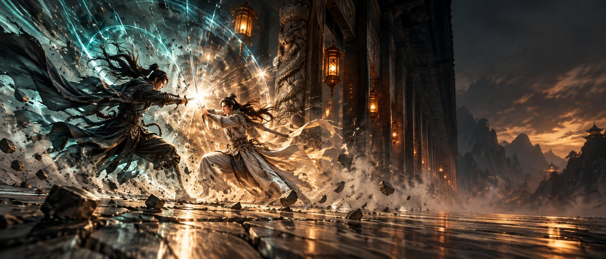
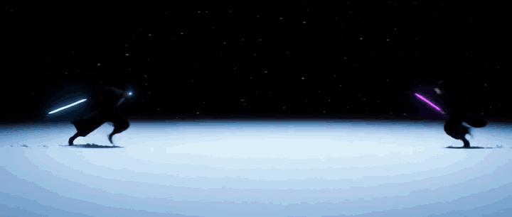
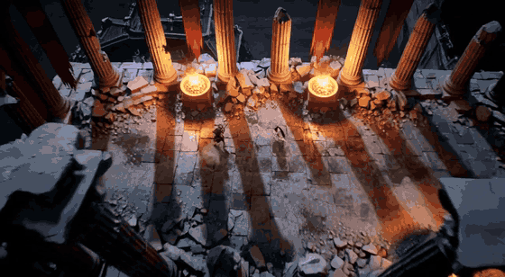
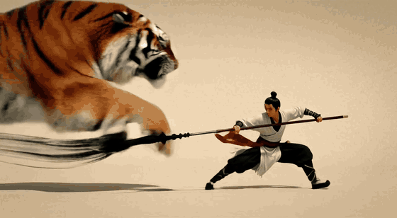
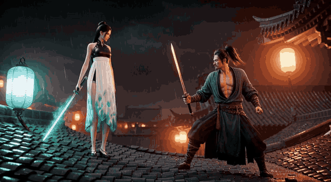
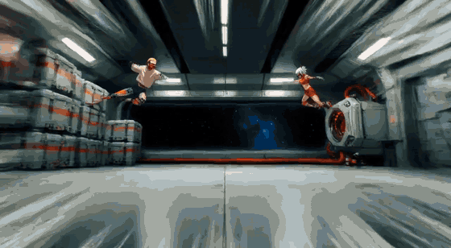
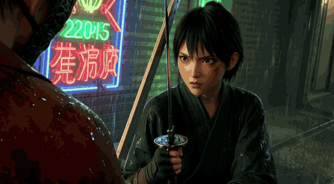
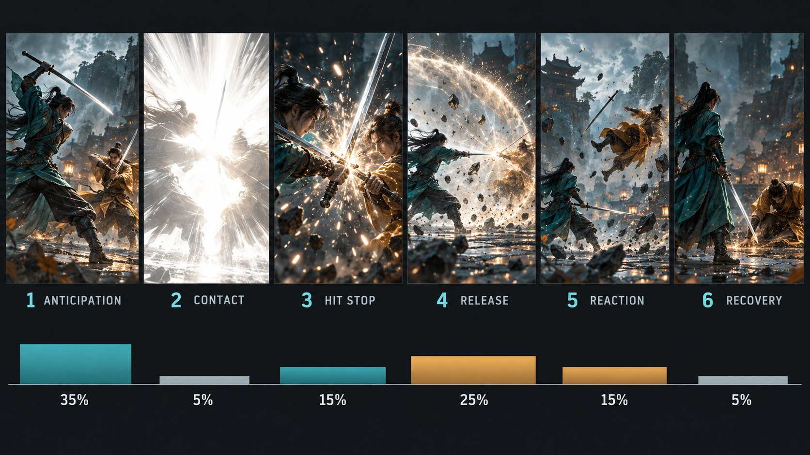
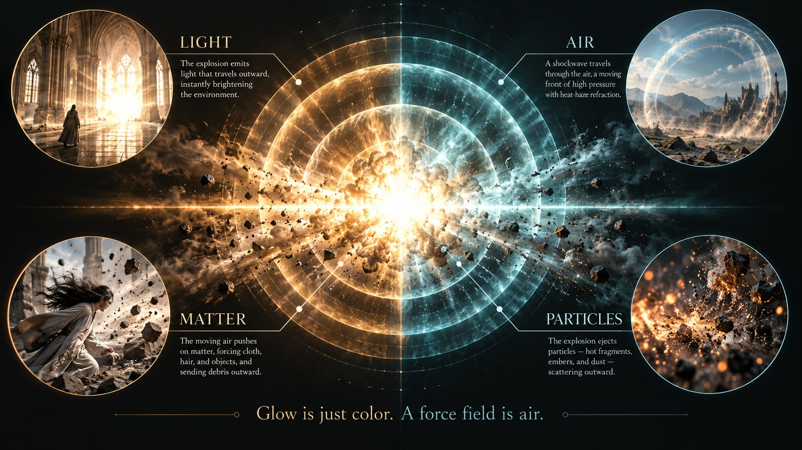

<p align="center">
  
</p>

<h1 align="center">h3-combat-impact</h1>

<p align="center">
  <b>A complete combat Agent Skill for MiniMax H3 / Hailuo: move design, choreography, VFX layering, fight camera, facial performance, impact frames and screen shake, reference fidelity, chaining, speed-ramp assembly and compositing.</b>
</p>

<p align="center">
  <b>English</b> · <a href="README.zh-TW.md">繁體中文</a>
</p>

<p align="center">
  <a href="LICENSE"></a>
  
  
  
  
</p>

---

## Showcase

Every clip below was generated by MiniMax H3 on a local RTX 4060 Ti (8 GB) from the prompts in [`examples/`](examples/): fixed seed, 24 fps, `high` quality, 1280×704 (21:9 clip: 1280×544). Click a title for the full MP4.

<table>
  <tr>
    <td align="center" width="50%">
      <a href="assets/showcase/blade-light.mp4"></a><br>
      <b><a href="assets/showcase/blade-light.mp4">21:9 blade-light</a></b><br>
      <sub>Back-lit silhouettes on blue snow, one violet intruder colour · <a href="examples/blade-light-21x9.txt">prompt</a></sub>
    </td>
    <td align="center" width="50%">
      <a href="assets/showcase/ultra-speed.mp4"></a><br>
      <b><a href="assets/showcase/ultra-speed.mp4">Ultra-speed, drone-style camera</a></b><br>
      <sub>12 shots in 8 s, a new camera position every cut · <a href="examples/ultra-speed-drone.txt">prompt</a></sub>
    </td>
  </tr>
  <tr>
    <td align="center">
      <a href="assets/showcase/ink-wash.mp4"></a><br>
      <b><a href="assets/showcase/ink-wash.mp4">Ink-wash burst</a></b><br>
      <sub>Ink spikes plus a one-frame flip instead of a freeze · <a href="examples/ink-wash.txt">prompt</a></sub>
    </td>
    <td align="center">
      <a href="assets/showcase/six-beat.mp4"></a><br>
      <b><a href="assets/showcase/six-beat.mp4">Six-beat single strike</a></b><br>
      <sub>Wind-up, white-out, shockwave, knock-back · <a href="examples/six-beat-single-hit.txt">prompt</a> (rewritten 2026-10 after H3 tests; the clip was made with the old prompt)</sub>
    </td>
  </tr>
  <tr>
    <td align="center">
      <a href="assets/showcase/anime-30s.mp4"></a><br>
      <b><a href="assets/showcase/anime-30s.mp4">30 s 2D-anime brawl from two reference images</a></b><br>
      <sub>2 × 15 s Ref2VA, identity-locked · <a href="examples/anime-ref2va-part1.txt">part 1</a> · <a href="examples/anime-ref2va-part2.txt">part 2</a></sub>
    </td>
    <td align="center">
      <a href="assets/showcase/face.mp4"></a><br>
      <b><a href="assets/showcase/face.mp4">Facial performance</a></b><br>
      <sub>Muscle actions, not adjectives · <a href="examples/facial-performance.txt">prompt</a></sub>
    </td>
  </tr>
  <tr>
    <td align="center" colspan="2">
      <a href="assets/showcase/impact-composite.mp4"></a><br>
      <b><a href="assets/showcase/impact-composite.mp4">Impact frames added in post</a></b><br>
      <sub>The main clip has none; a separate H3 manga-burst clip supplies 3 × 2 frames, composited frame-exact · <a href="references/impact-frame/post.md">how</a></sub>
    </td>
  </tr>
</table>

The 30 s brawl is a recreation, not a copy: it follows the structure of a public Seedance 2.5 showcase (shot list, colour re-keys per blast, hangar layout) rewritten for H3's format and limits. The reference character images are not included.

## Why this skill

AI fight clips usually fail the same ways: the action is soft, the VFX is a glowing sticker, two characters pose like wooden dolls, faces are dead, the camera orbits, and the last two seconds stand still. "Epic explosion" fixes none of that.

This skill turns "make the fight look good" into a **mandatory workflow** where every step can be written, copied and measured:

**move design → choreography → VFX layering → camera → impact-point list and route → prompt → validation → post / assembly commands**

- **A full combat skill, not an impact-frame skill.** Impact frames are one mandatory branch; without good moves and real exchanges, no impact frame saves the shot.
- **Use it with h3-video-prompting.** Generic H3 format follows the official schema; fighting, moves, VFX, impact frames, speed ramps and shot-length exceptions follow this skill.
- **Hit structure.** Anticipation → contact → release → reaction → recovery. The old "hit stop" beat moved to assembly (H3 stretches `near-freeze` into 0.5–1 s).
- **Force field, not glow.** Light / air / matter / particles. The cheapest proof of power is a robe or hair being pushed.
- **Named moves.** 16 moves with four layers each, so the model stops averaging into "swing, block, retreat".
- **Rhythm modes.** Six-beat, continuous brawl, and ULTRA_SPEED (10–14 shots in 8 s, new camera position every cut).
- **Reference fidelity.** A 9-class identity checklist for Ref2VA so the character stays *that* character.
- **Impact-frame decision card (P0–P3).** H3 ignores frame counts (`for two frames` measured 11–45 lit frames), so the prompt only produces cuttable material and frame counts and speed are set in assembly. Ultimates default to a burst strip plus a 5× ramp.
- **Three deliverables.** A paste-ready prompt code block, an impact-frame plan, and assembly commands. The validator flags ultimates with no impact frame, slow words, inline manga panels, and white flashes paired with continuous shake.
- **Measured, not felt.** Scripts score motion, light events, staging and seams on the finished MP4.

## Hit structure (formerly six beats, revised 2026-10)

<p align="center">
  <br>
  <sub>The original six-beat diagram. Beat 3 "hit stop" is no longer written into the prompt; it is done in assembly (duplicate frames before contact, or a 0.15–0.25 s reveal after the cut).</sub>
</p>

| Beat | What the frame needs | Prompt key phrase |
|---|---|---|
| 1 Anticipation | counter-motion, energy gathering, gravel lifting (**no stillness words**) | `weight sinks into the rear leg`, `the lights die one by one toward the target` |
| 2 Contact | **impact point**: pick P0–P3 from the decision card | `the frame blows out to white at the instant of contact, then snaps straight back` |
| 3 Release | shockwave, debris, dust ring, light shift (max three force channels) | `a ring of shockwave dust bursts outward` |
| 4 Reaction | defender thrown in the same sentence, delayed cloth and hair, decaying shake | `in the same unbroken moment he is hurled back` |
| 5 Recovery | back to guard, embers fall, camera steadies | `settles into a low guard` |

## Impact-frame decision card

| Route | When | Prompt | Assembly |
|---|---|---|---|
| P0 no full-frame | L1–L2, realistic 3D CG | local star-burst + background radial smear | — |
| P1 in-shot light event | single L3 hit | white-out + `then snaps straight back`, no frame count | trim to 1–2 frames |
| **P2 burst strip + ramp** | **ultimates, finishers, one-hit kills (default)** | its own 3–5 images, ~0.2 s each, same composition, new palette each, each harsher | `impact_frame.py ramp`: 5× / 1.5× |
| P3 separate clip + composite | manga panels, frame-exact hits, ULTRA_SPEED | main clip has none; generate an impact clip | `impact_frame.py composite` |

Finished-length tiers (measured on reference clips): short flash 1–2 frames | sequence 6–13 frames | radial hold board 9–12 frames. Banned slow words on H3: `near-freeze`, `hangs poised`, `like a meteor`, `for half a second`… ([`burst-strip.md`](references/impact-frame/burst-strip.md)).

One visual climax per hit. For non-stop brawls use the four-beat mode with no freeze ([`continuous-brawl.md`](references/continuous-brawl.md)); for "breathless" cutting use [`ultra-speed.md`](references/ultra-speed.md).

## Force field: glow is just colour

<p align="center">
  <br>
  <sub>Open at most three channels per hit. Priority: air &gt; matter &gt; light &gt; particles.</sub>
</p>

```text
✗  epic explosion, glowing shockwave
✓  wind pressure flattens the silk against her body, the air ripples in a heat-haze ring,
   roof tiles rattle loose
```

## Every prompt type, tested

All runs use the same seed. "End ÷ mid" is the last 2 s of motion divided by the middle of the clip ([`measure_motion.py`](scripts/measure_motion.py), pass ≥ 60%). Numbers are from the draft (`light`) run unless the HQ column says otherwise.

| Prompt type | Example | First draft | After fix / HQ | Verdict |
|---|---|---|---|---|
| Six-beat single hit | [`six-beat-single-hit.txt`](examples/six-beat-single-hit.txt) | 110%; white-out frame lands, slow opening | HQ 73% | Passes; keep the wind-up short (numbers are from the old prompt; the current one drops near-freeze / for two frames and **needs a rerun**) |
| Continuous brawl | [`continuous-brawl.txt`](examples/continuous-brawl.txt) | end ÷ mid 118%, quiet motion | – | Usable, calm; not showcased |
| ULTRA_SPEED + drone camera | [`ultra-speed-drone.txt`](examples/ultra-speed-drone.txt) | 95% | HQ 80% | **Strong** |
| 21:9 blade-light | [`blade-light-21x9.txt`](examples/blade-light-21x9.txt) | 84% | HQ 67% | Passes (HQ marginal); dark frames depress the score, judge by eye |
| Force-field explosion | [`force-field-explosion.txt`](examples/force-field-explosion.txt) | **28%**, subject frozen | 66% after rewrite; HQ 43% | Weak, still needs work |
| Ink-wash burst | [`ink-wash.txt`](examples/ink-wash.txt) | 71% | HQ 52% (tail stall) | HQ below the 60% bar; looks right, ending is quiet |
| Facial performance | [`facial-performance.txt`](examples/facial-performance.txt) | **40%** | 133% after rewrite; HQ 182% | Strong after the fix |
| Ref2VA identity lock | [`anime-ref2va-part1.txt`](examples/anime-ref2va-part1.txt) | 94% | HQ 89% | **Strong** |
| Ref2VA, second 15 s | [`anime-ref2va-part2.txt`](examples/anime-ref2va-part2.txt) | **34%** | 88% after rewrite; HQ 93% | Strong after the fix |
| I2VA effects insert | [`SKILL.md`](SKILL.md) | palette kept (steel-blue + gold); first-frame PSNR ≈ 20 dB | – | Good as a 1–4 s insert; low motion |
| Impact frames in post | [`impact-frame-source.txt`](examples/impact-frame-source.txt) | 6 contiguous frames verified | – | Works on 24 fps main clips, frame-exact |

Two changes were made together on those clips, so I cannot separate them:

- **End the last shot mid-motion.** `both fighters are still mid-motion as the frame ends` took the force-field clip from 28% to 66%, the face clip from 40% to 133%, and the 15 s anime part from 34% to 88%. A last shot that says "hold" or "settle" gets frozen by H3.
- **Rewrite static single shots as 3–4 cut shots** with a position change and a world reaction in each.

A/B on prompt format (15 s Ref2VA, same references and seed): an author-style Chinese prompt with a time-range prefix on `[Shot 1]` scored 108% end ÷ mid, the official format 113%; neither stalled. The validator still enforces the official format ([`fl2va-chain.md`](references/fl2va-chain.md) §5.6).

## Install

```bash
git clone https://github.com/ayase0307/h3-combat-impact ~/.claude/skills/h3-combat-impact
```

Works with any agent that reads `SKILL.md` skills (Claude Code, Codex, …). Windows: clone into `%USERPROFILE%\.claude\skills\`.

Then ask in plain language:

> *"Write an H3 prompt for an 8-second rooftop duel, it feels floaty, make it hit."*
> *"Break this fight clip down and recreate it in H3 format."*
> *"This ultimate has no punch, make it world-ending."*
> *"Design three moves for each character and choreograph a 15-second exchange."*
> *"Make this reference character fight in a space-station hangar, 30 seconds."*

## Tools

```bash
# format check before you paste into the model (FAIL must be fixed)
python scripts/validate_prompt.py prompt.txt --duration 8

# motion curve of generated clips (needs ffmpeg on PATH)
python scripts/measure_motion.py --dir ./outputs
python scripts/measure_motion.py ref.mp4 --fps24            # normalise to 24 fps before comparing

# where did the impact frames actually land?
python scripts/impact_frame.py find-peak --in clip.mp4

# P2: burst strip 5x, main VFX 1.5x (audio is ramped too)
python scripts/impact_frame.py ramp --in clip.mp4 --seg 1.40-2.21:5 --seg 2.21-3.96:1.5 --out clip.ramped.mp4

# P3: auto-pick the brightest / most desaturated frame of the impact clip, lay it on main frame 93 for 2 frames
# (auto-scaled to the main clip, audio kept, acceptance numbers printed)
python scripts/impact_frame.py composite --main main.mp4 --impact burst.mp4 \
    --insert 93:auto:2 --out out.mp4

# tests
python -m unittest discover -s tests
```

| Metric | Pass |
|---|---|
| Opening 0.8 s | ≥ 50% of middle |
| End 2 s ÷ middle | ≥ 60% (when chaining or a moving ending is required) |
| Longest lull | ≤ 0.8 s |
| Peaks | ≥ 4 |

> Thresholds are calibrated on 24 fps footage. A clip that *claims* 60 fps may be 24 fps with pulldown, and 30 fps footage scores ~20% low; use `--fps24` before comparing.

## What's inside

| File | Covers |
|---|---|
| [`SKILL.md`](SKILL.md) | Core: skill split, 8-step mandatory workflow, impact-frame decision card, rhythm modes, contract and deliverables, which reference to read when |
| [`references/output-format.md`](references/output-format.md) | Official 3-field / 6-field contract, alignment line, dialogue tags, **impact-frame plan and assembly commands** |
| [`references/ultimate-moves.md`](references/ultimate-moves.md) | Ultimates, finishers, one-hit kills (3 shots × 3 kill logics), transformation, delayed hit, consequences |
| [`references/impact-frame/forms.md`](references/impact-frame/forms.md) | The single impact-frame form table (14 forms), three length tiers, realistic recipe, retired phrasings |
| [`references/impact-frame/burst-strip.md`](references/impact-frame/burst-strip.md) | P2 burst strip + speed ramp (default for ultimates), H3 slow-word ban list |
| [`references/impact-frame/post.md`](references/impact-frame/post.md) | P3 separate generation + compositing, two-part acceptance |
| [`references/impact-frame/shake-and-timing.md`](references/impact-frame/shake-and-timing.md) | Screen shake (short jolt / counted decay), where pauses belong, explosion timing |
| [`references/impact-design.md`](references/impact-design.md) | Hit structure, power tiers L1–L4, three-tier clash system, material reactions |
| [`references/move-library.md`](references/move-library.md) | 16 named moves, 4 chains, EN/ZH translation rules |
| [`references/choreography.md`](references/choreography.md) | Move quotas, real throws vs locks, three heights, speed-method ranking, hard constraints |
| [`references/cinematic-camera.md`](references/cinematic-camera.md) | Speed tiers, causal moves, ten positions, Z-axis dead stop, swallow-the-lens endings |
| [`references/continuous-brawl.md`](references/continuous-brawl.md) | Non-stop four-beat mode |
| [`references/ultra-speed.md`](references/ultra-speed.md) | ULTRA_SPEED: 10–14 shots in 8 s, bimodal shot lengths, mandatory post step |
| [`references/drone-camera.md`](references/drone-camera.md) | Drone camera: 8 positions, five scales, top-down de-duplication |
| [`references/blade-light-cinema.md`](references/blade-light-cinema.md) | Blade cinematography, manga impact panels, single-hue night |
| [`references/ref-identity-lock.md`](references/ref-identity-lock.md) | Reference fidelity: 9 identity classes, art-style anchors |
| [`references/facial-performance.md`](references/facial-performance.md) | Expression as muscle actions |
| [`references/fl2va-chain.md`](references/fl2va-chain.md) | Two-segment chaining, seams, white-seam joins, per-segment edit plan |
| [`references/force-field.md`](references/force-field.md) | Four channels, three field types, phrase bank |
| [`references/camera-grammar.md`](references/camera-grammar.md) | Official camera vocabulary, fight camera patterns |
| [`references/vfx-vocabulary.md`](references/vfx-vocabulary.md) | Bilingual VFX word bank, three palette rules, lightning / magic smoke / absorbed energy |
| [`references/prompt-templates.md`](references/prompt-templates.md) | Fill-in T2VA / FL2VA / Ref2VA templates, **template F for ultimates** |
| [`references/qa-checklist.md`](references/qa-checklist.md) | Pre- and post-generation checks, failure → fix |
| [`references/lab-notes.md`](references/lab-notes.md) | Measurement rules, tools, controlled A/B records |
| [`references/guided-mode.md`](references/guided-mode.md) | Guided mode: entry paths and scenario options |
| [`references/case-wuxia-duel.md`](references/case-wuxia-duel.md) | A 27.5 s duel broken down and rebuilt |
| [`examples/`](examples/) | The ten prompts used in the showcase and the table above |
| [`scripts/`](scripts/) | `validate_prompt`, `impact_frame` (find-peak / ramp / composite / gen), `measure_motion`, `measure_staging`, `measure_light_event`, `submit_ref2va`, `submit_chain`, `seam_check`, `submit_ab`, `poll_ab`, `compare_clips` |
| [`tests/`](tests/) | Validator fixtures and end-to-end `impact_frame.py` tests: `python -m unittest discover -s tests` |

## Honest limits

- Numbers come from my own runs on one rig, one seed per prompt. They are evidence, not a benchmark.
- The motion score measures picture change, not subject motion; dark or silhouette footage scores low even when it looks right. Always check by eye.
- High-quality reruns are a different sample from the draft, so scores move; the table shows both.
- The force-field type is still weak at high quality.
- The case study and the 30 s brawl analyse third-party reference clips; those clips and their character images are not included.
- H3 has no negative-prompt field; every "don't" is rewritten as a positive constraint.
- Most rules added from the new tutorials in the 2026-10 revision are **untested on H3** (marked line by line). The P2 burst strip has one H3 run (EP03 S04-a d17); image count, anti-panel phrasing and colour-negative frames still need fixed-seed tests.

## License

MIT
