<p align="center">
  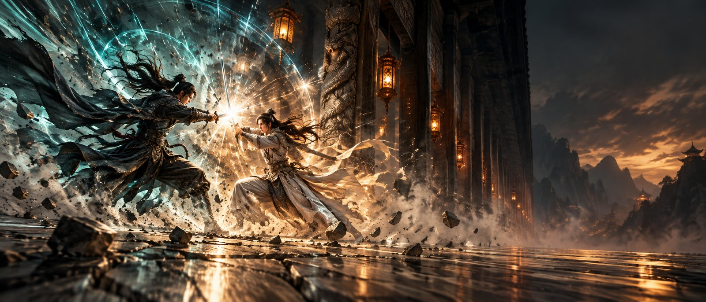
</p>

<h1 align="center">h3-combat-impact</h1>

<p align="center">
  <b>Agent Skill that makes MiniMax H3 / Hailuo fights <i>hit</i>: impact beats, named moves, force fields, impact frames, drone-style camera.</b>
</p>

<p align="center">
  <b>English</b> · <a href="README.zh-TW.md">繁體中文</a>
</p>

<p align="center">
  <a href="LICENSE"></a>
  
  
  
  
</p>

---

## Showcase

Unless its caption says otherwise, every clip below was generated by MiniMax H3 on a local RTX 4060 Ti (8 GB) from the prompts in [`examples/`](examples/): fixed seed, 24 fps, `high` quality, 1280×704 (21:9 clip: 1280×544). Click a title for the full MP4.

<table>
  <tr>
    <td align="center" width="50%">
      <a href="assets/showcase/blade-light.mp4">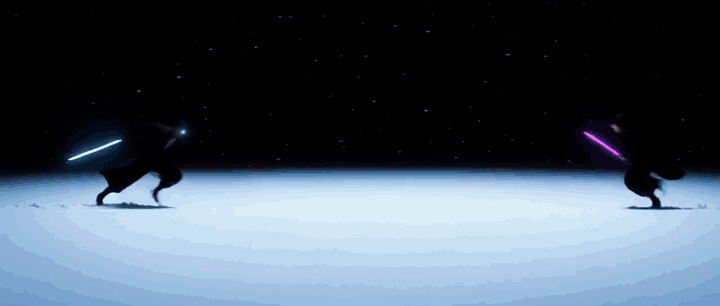</a><br>
      <b><a href="assets/showcase/blade-light.mp4">21:9 blade-light</a></b><br>
      <sub>Back-lit silhouettes on blue snow, one violet intruder colour · <a href="examples/blade-light-21x9.txt">prompt</a></sub>
    </td>
    <td align="center" width="50%">
      <a href="assets/showcase/ultra-speed.mp4">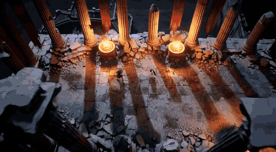</a><br>
      <b><a href="assets/showcase/ultra-speed.mp4">Ultra-speed, drone-style camera</a></b><br>
      <sub>12 shots in 8 s, a new camera position every cut · <a href="examples/ultra-speed-drone.txt">prompt</a></sub>
    </td>
  </tr>
  <tr>
    <td align="center">
      <a href="assets/showcase/ink-wash.mp4">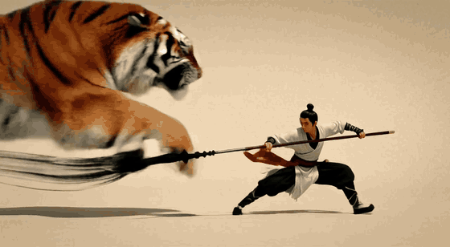</a><br>
      <b><a href="assets/showcase/ink-wash.mp4">Ink-wash burst</a></b><br>
      <sub>Ink spikes plus a one-frame flip instead of a freeze · <a href="examples/ink-wash.txt">prompt</a></sub>
    </td>
    <td align="center">
      <a href="assets/showcase/six-beat.mp4">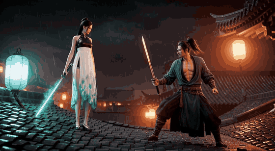</a><br>
      <b><a href="assets/showcase/six-beat.mp4">Six-beat single strike</a></b><br>
      <sub>Wind-up, white-out, shockwave, knock-back · <a href="examples/six-beat-single-hit.txt">prompt</a></sub>
    </td>
  </tr>
  <tr>
    <td align="center">
      <a href="assets/showcase/anime-30s.mp4">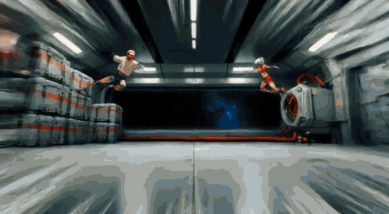</a><br>
      <b><a href="assets/showcase/anime-30s.mp4">30 s 2D-anime brawl from two reference images</a></b><br>
      <sub>2 × 15 s Ref2VA, identity-locked · <a href="examples/anime-ref2va-part1.txt">part 1</a> · <a href="examples/anime-ref2va-part2.txt">part 2</a></sub>
    </td>
    <td align="center">
      <a href="assets/showcase/face.mp4">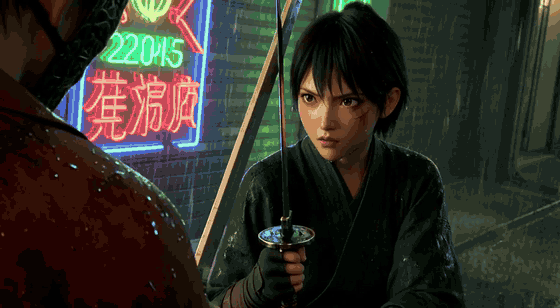</a><br>
      <b><a href="assets/showcase/face.mp4">Facial performance</a></b><br>
      <sub>Muscle actions, not adjectives · <a href="examples/facial-performance.txt">prompt</a></sub>
    </td>
  </tr>
  <tr>
    <td align="center">
      <a href="assets/showcase/character-bloodmoon.mp4">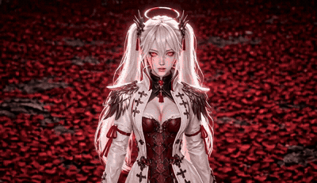</a><br>
      <b><a href="assets/showcase/character-bloodmoon.mp4">Character recreation A · Blood-moon maiden</a></b><br>
      <sub>10 s Ref2VA from three self-made references (turnaround / halberd / shatter plate) · <a href="examples/bloodmoon-ultimate-ref2va.txt">prompt</a></sub>
    </td>
    <td align="center">
      <a href="assets/showcase/character-jade.mp4">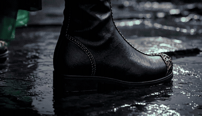</a><br>
      <b><a href="assets/showcase/character-jade.mp4">Character recreation B · Umbrella cultivator</a></b><br>
      <sub>10 s Ref2VA from three self-made references (turnaround / umbrella / rift plate) · <a href="examples/jade-rift-summon-ref2va.txt">prompt</a></sub>
    </td>
  </tr>
  <tr>
    <td align="center" colspan="2">
      <a href="assets/showcase/impact-inline.mp4">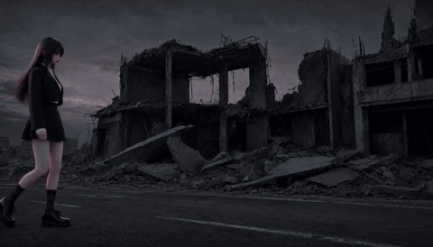</a><br>
      <b><a href="assets/showcase/impact-inline.mp4">Impact frames written in the prompt</a></b><br>
      <sub>One H3 take, nothing composited: every card comes from the model. Only the card run is sped up 2.5× in the edit, and the tail is trimmed. Best of 3 seeds; another came out as a triptych · Pika H3 Flex, RTX 5070 Ti, 1344×768 · <a href="examples/impact-frame-inline.txt">prompt</a> · <a href="references/impact-frame-inline.md">how</a></sub>
    </td>
  </tr>
</table>

The 30 s brawl is a recreation, not a copy: it follows the structure of a public Seedance 2.5 showcase (shot list, colour re-keys per blast, hangar layout) rewritten for H3's format and limits. The reference character images are not included.

The impact-frame clip was made while remaking a public Seedance impact-frame tutorial. Its character and street reference images are not included.

## Why this skill

AI fight clips usually fail the same ways: the action is soft, the VFX is a glowing sticker, two characters pose like wooden dolls, faces are dead, the camera orbits, and the last two seconds stand still. "Epic explosion" fixes none of that.

This skill turns "make it hit harder" into structure you can write, copy and **measure**:

- **Six-beat impact.** Anticipation → contact → hit stop → release → reaction → recovery, with a time budget per beat.
- **Five parts per shot.** Camera / Motion / Performance / Light / Sound, and **Motion must carry the weight transfer** — the cheapest source of impact there is.
- **Speed is action density.** Not adjectives: 1–2 s shots × 3 named actions each, so 18–24 actions in 8 s.
- **Force field, not glow.** Light / air / matter / particles. The cheapest proof of power is a robe or hair being pushed.
- **Named moves.** 16 moves with four layers each, so the model stops averaging into "swing, block, retreat".
- **VFX with shape and scale.** A three-step translation for invented moves: physical noun → path → what the target actually becomes.
- **Rhythm modes.** Six-beat, continuous brawl, and ULTRA_SPEED (10–14 shots in 8 s, new camera position every cut).
- **Reference fidelity.** A 9-class identity checklist for Ref2VA so the character stays *that* character.
- **Impact frames, three routes.** Multi-card flash-cut (give the cards enough time, then speed them up in the edit), a 0.3 s six-layer transformation, or frame-exact post compositing.
- **Portable signature skills.** A ten-field character card, a four-node skill motif and eight motif archetypes — any character can wear them.
- **Output you can paste.** One code block in the official H3 format, checked by a validator.
- **Measured, not felt.** Scripts score motion, light events, staging and seams on the finished MP4.

## The six beats

<p align="center">
  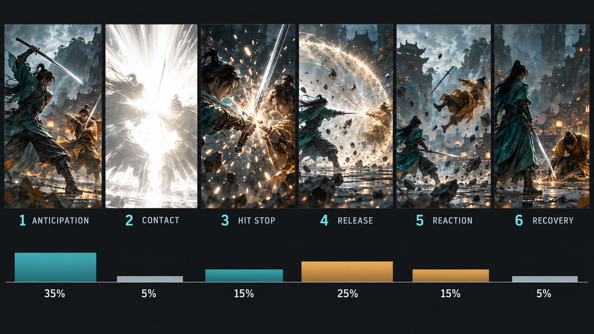<br>
  <sub>One strike, six beats, and the share of time each one gets. No wind-up, no weight.</sub>
</p>

| Beat | Share | What the frame needs | Prompt key phrase |
|---|---:|---|---|
| 1 Anticipation | 35% | counter-motion, weight sinks, cloth tightens | `weight sinks into the rear leg` |
| 2 Contact | 5% | **impact frame**: 1–2 frames of white-out / black-out | `for two frames the entire frame blows out to pure white` |
| 3 Hit stop | 15% | time almost freezes, dust and sparks hang | `decelerates to a near-freeze for two frames` |
| 4 Release | 25% | shockwave, debris, dust ring, light shift | `a ring of shockwave dust bursts outward` |
| 5 Reaction | 15% | defender hurled back, delayed cloth and hair, **decaying shake** | `the shake decays within a third of a second` |
| 6 Recovery | 5% | back to guard, embers fall, camera steadies | `settles into a low guard` |

Anticipation ≥ 5× contact; one visual climax per hit. For non-stop brawls use the four-beat mode with no freeze ([`continuous-brawl.md`](references/continuous-brawl.md)); for "breathless" cutting use [`ultra-speed.md`](references/ultra-speed.md).

## Force field: glow is just colour

<p align="center">
  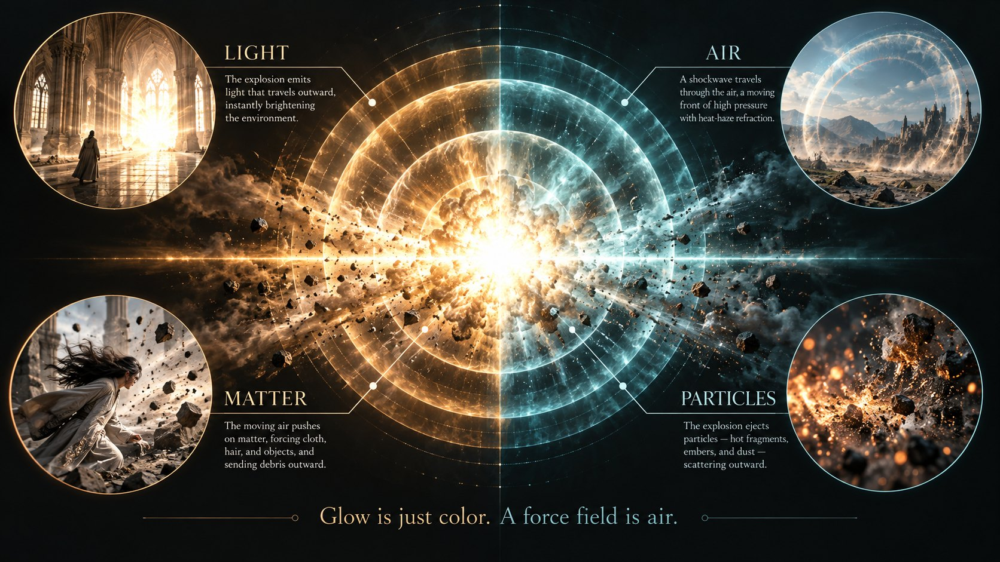<br>
  <sub>Open at most three channels per hit. Priority: air &gt; matter &gt; light &gt; particles.</sub>
</p>

```text
✗  epic explosion, glowing shockwave
✓  wind pressure flattens the silk against her body, the air ripples in a heat-haze ring,
   roof tiles rattle loose
```

## Five parts per shot

A fight shot has to do four things at once: change the camera, run the action, act the face and blow something up.
Write only the action and the model averages all four — no camera landing point, no weight, a dead face, flat light.

| Part | What a fight shot must contain |
|---|---|
| **① Camera** | focal length + distance + height; move amplitude / speed / duration; **where she starts and ends in frame** |
| **② Motion** | start → force point → **support and weight** → inertia → end (still one main action per shot) |
| **③ Performance** | brows / lower lid / jaw / lips / throat / breath — body part plus motion, never an adjective |
| **④ Light** | source direction + colour temperature; **the VFX itself is a light source**; consistent across cuts |
| **⑤ Sound** | in-shot effects **with seconds**, ambience, when the line starts |

**Weight transfer is the cheapest impact you can write.** Same move, two very different clips:

```text
✗  She swings the halberd.
✓  Her weight sinks into the rear leg, she drives off that heel, the front foot takes
   the whole body, her hips rotate ahead of her shoulders, and her mass arrives behind
   the blade head at the moment of contact.
```

Four weight parameters, pick one or two per shot: **loaded foot**, **hip travel**, **pivot point**, **lost balance**.
Writing all five parts costs 120–190 English words per shot; a 10 s six-shot Ref2VA lands at
~1300 words / 7.4k characters, already against the 7500-character submission cap — split the segment beyond that.

```bash
python scripts/validate_prompt.py prompt.txt --duration 8 --five-part
```

## Character × signature skill: a portable system

What reads as good is not "many moves" — it is **one fixed skill motif plus one visual grammar that never changes**.
So "reproduce this" means reproducing *how the character's skill is seen*, not copying shots.

| Layer | Content | When you swap characters |
|---|---|---|
| ① Character card | ten identity anchors (silhouette / face / one unforgiven mark / hair / accessory counts / three costume layers / colour ownership / weapon / rhythm / one line) | replace whole layer |
| ② Skill motif | trigger → formation → impact → residue, four nodes **that must be separate shots** | transfer whole |
| ③ Visual grammar | one colour, one shape, one sound, one residue | usually keep |

<table>
  <tr>
    <td align="center" width="50%">
      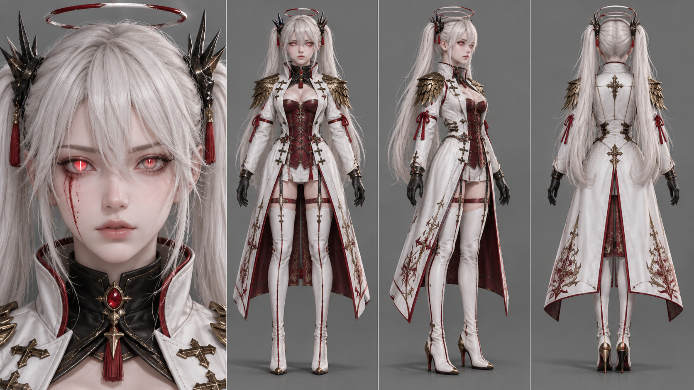
      <br><b>A · Blood-moon maiden, "White Rose, One Snap"</b>
      <br><sub>Shattered-mirror domain → sky-falling light pillar. One trigger only: a finger snap.</sub>
    </td>
    <td align="center" width="50%">
      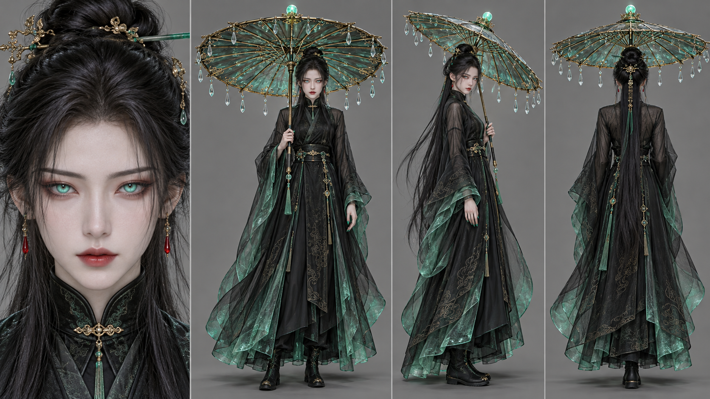
      <br><b>B · Umbrella cultivator, "Azure Luan, Rift"</b>
      <br><sub>Rift summon → three rune-covered jade hands claw the tear open.</sub>
    </td>
  </tr>
</table>

Eight motif archetypes (shattered-mirror domain, rift summon, sky pillar, afterimage flurry, colossal suppression,
freeze, devouring vortex, echo duplicates) times five swappable variables (trigger, formation carrier, impact mode,
residue, accent colour) — any character can wear any of them.

Asset order: **turnaround sheet → weapon/prop → skill VFX plate → keyframe**. The sheet is a Ref2VA identity
reference, **not an I2VA first frame** — an image model's render style is far enough from H3's that a first frame
built from it makes the whole clip jump.

See [`character-signature-skill.md`](references/character-signature-skill.md),
[`bloodmoon-ultimate-ref2va.txt`](examples/bloodmoon-ultimate-ref2va.txt),
[`jade-rift-summon-ref2va.txt`](examples/jade-rift-summon-ref2va.txt).

## Every prompt type, tested

All runs use the same seed. "End ÷ mid" is the last 2 s of motion divided by the middle of the clip ([`measure_motion.py`](scripts/measure_motion.py), pass ≥ 60%). Numbers are from the draft (`light`) run unless the HQ column says otherwise.

| Prompt type | Example | First draft | After fix / HQ | Verdict |
|---|---|---|---|---|
| Six-beat single hit | [`six-beat-single-hit.txt`](examples/six-beat-single-hit.txt) | 110%; white-out frame lands, slow opening | HQ 73% | Passes; keep the wind-up short |
| Continuous brawl | [`continuous-brawl.txt`](examples/continuous-brawl.txt) | end ÷ mid 118%, quiet motion | – | Usable, calm; not showcased |
| ULTRA_SPEED + drone camera | [`ultra-speed-drone.txt`](examples/ultra-speed-drone.txt) | 95% | HQ 80% | **Strong** |
| 21:9 blade-light | [`blade-light-21x9.txt`](examples/blade-light-21x9.txt) | 84% | HQ 67% | Passes (HQ marginal); dark frames depress the score, judge by eye |
| Force-field explosion | [`force-field-explosion.txt`](examples/force-field-explosion.txt) | **28%**, subject frozen | 66% after rewrite; HQ 43% | Weak, still needs work |
| Ink-wash burst | [`ink-wash.txt`](examples/ink-wash.txt) | 71% | HQ 52% (tail stall) | HQ below the 60% bar; looks right, ending is quiet |
| Facial performance | [`facial-performance.txt`](examples/facial-performance.txt) | **40%** | 133% after rewrite; HQ 182% | Strong after the fix |
| Ref2VA identity lock | [`anime-ref2va-part1.txt`](examples/anime-ref2va-part1.txt) | 94% | HQ 89% | **Strong** |
| Ref2VA, second 15 s | [`anime-ref2va-part2.txt`](examples/anime-ref2va-part2.txt) | **34%** | 88% after rewrite; HQ 93% | Strong after the fix |
| I2VA effects insert | [`SKILL.md`](SKILL.md) | palette kept (steel-blue + gold); first-frame PSNR ≈ 20 dB | – | Good as a 1–4 s insert; low motion |
| Impact frames in post | [`impact-frame-source.txt`](examples/impact-frame-source.txt) | 6 contiguous frames verified | – | Works on 24 fps main clips, frame-exact |
| Impact frames in the prompt (Pika H3 Flex) | [`impact-frame-inline.txt`](examples/impact-frame-inline.txt) | 3 seeds: 1 long full-screen run, 1 triptych, 1 shorter three-card run | – | Readable but not exact; written as 3 cards in 0.6 s, came out as about 5 looks in 1.3 s, 0.3 s late. Kept verbatim as run, so `validate_prompt` flags `<Picture 1>` as undeclared |
| Character recreation A (10 s) | [`bloodmoon-ultimate-ref2va.txt`](examples/bloodmoon-ultimate-ref2va.txt) | end ÷ mid 32% (the finale is a deliberate locked-off tableau) | – | identity, costume and skill shape all held; 9 shots, 55.6% with light events |
| Character recreation B (10 s) | [`jade-rift-summon-ref2va.txt`](examples/jade-rift-summon-ref2va.txt) | end ÷ mid **161%**; peaks 23; longest trough 1.42 s | – | rift and claws formed correctly; light-event score under-reads a dark monochrome scene |

Two changes were made together on those clips, so I cannot separate them:

- **End the last shot mid-motion.** `both fighters are still mid-motion as the frame ends` took the force-field clip from 28% to 66%, the face clip from 40% to 133%, and the 15 s anime part from 34% to 88%. A last shot that says "hold" or "settle" gets frozen by H3.
- **Rewrite static single shots as 3–4 cut shots** with a position change and a world reaction in each.

A/B on prompt format (15 s Ref2VA, same references and seed): an author-style Chinese prompt with a time-range prefix on `[Shot 1]` scored 108% end ÷ mid, the official format 113%; neither stalled. The validator still enforces the official format ([`fl2va-chain.md`](references/fl2va-chain.md) §5.6).

## Install

```bash
git clone https://github.com/ayase0307/h3-combat-impact ~/.claude/skills/h3-combat-impact
```

Works with any agent that reads `SKILL.md` skills (Claude Code, Codex, …). Windows: clone into `%USERPROFILE%\.claude\skills\`.

Then ask in plain language:

> *"Write an H3 prompt for an 8-second rooftop duel, it feels floaty, make it hit."*
> *"Break this fight clip down and recreate it in H3 format."*
> *"Make this reference character fight in a space-station hangar, 30 seconds."*

## Tools

```bash
# format check before you paste into the model (FAIL must be fixed)
python scripts/validate_prompt.py prompt.txt --duration 8

# motion curve of generated clips (needs ffmpeg on PATH)
python scripts/measure_motion.py --dir ./outputs
python scripts/measure_motion.py ref.mp4 --fps24            # normalise to 24 fps before comparing

# composite impact frames in post (frame-exact: --at is frame/24)
python scripts/impact_frame.py composite --main main.mp4 --impact burst.mp4 \
    --at 3.875 --frame 3 --hold 0.083 --out out.mp4
```

| Metric | Pass |
|---|---|
| Opening 0.8 s | ≥ 50% of middle |
| End 2 s ÷ middle | ≥ 60% |
| Longest lull | ≤ 0.8 s |
| Peaks | ≥ 4 |

> Thresholds are calibrated on 24 fps footage. A clip that *claims* 60 fps may be 24 fps with pulldown, and 30 fps footage scores ~20% low; use `--fps24` before comparing.

## What's inside

| File | Covers |
|---|---|
| [`SKILL.md`](SKILL.md) | Schema, six-beat method, force field, design rules, workflow |
| [`references/output-format.md`](references/output-format.md) | Official 3-field / 6-field contract, alignment line, dialogue tags |
| [`references/impact-design.md`](references/impact-design.md) | Beat detail, power tiers, material reactions |
| [`references/move-library.md`](references/move-library.md) | 16 named moves, 4 chains, EN/ZH translation rules |
| [`references/continuous-brawl.md`](references/continuous-brawl.md) | Non-stop four-beat mode |
| [`references/choreography.md`](references/choreography.md) | Move quotas (blade-verb cap), real throws vs locks, three heights per chain |
| [`references/cinematic-camera.md`](references/cinematic-camera.md) | Three speed tiers, amplitude jumps, causal camera moves, ten cinematic positions |
| [`references/ultra-speed.md`](references/ultra-speed.md) | ULTRA_SPEED mode: 10-14 shots in 8 s, light event per shot |
| [`references/drone-camera.md`](references/drone-camera.md) | Drone camera: 8 positions, five scales, no orbit-only |
| [`references/blade-light-cinema.md`](references/blade-light-cinema.md) | 21:9 blade cinematography, manga impact panels, single-hue night |
| [`references/ref-identity-lock.md`](references/ref-identity-lock.md) | Reference fidelity: 9 identity classes, art-style anchors |
| [`references/facial-performance.md`](references/facial-performance.md) | Expression as muscle actions |
| [`references/impact-frame-and-shake.md`](references/impact-frame-and-shake.md) | Impact-frame forms, frame counts, shake decay, ink burst |
| [`references/impact-frame-post.md`](references/impact-frame-post.md) | Impact frames generated separately and composited |
| [`references/impact-frame-inline.md`](references/impact-frame-inline.md) | Impact frames written into the prompt: multi-card flash-cut, 0.3 s six-layer transformation, time-expansion maths |
| [`references/shot-five-part-combat.md`](references/shot-five-part-combat.md) | Five parts per shot, fight edition: four weight parameters, length budget, full example |
| [`references/speed-acceleration.md`](references/speed-acceleration.md) | Eight-tier speed ranking, action-density formula, working vs empty speed vocabulary |
| [`references/vfx-choreography.md`](references/vfx-choreography.md) | Five-part VFX skeleton, space and scale, three-step translation for invented moves |
| [`references/character-signature-skill.md`](references/character-signature-skill.md) | Ten-field character card, four-node skill motif, eight archetypes, measured runs |
| [`references/fl2va-chain.md`](references/fl2va-chain.md) | Two-segment chaining, seams, ending rules |
| [`references/force-field.md`](references/force-field.md) | Four channels, three field types, phrase bank |
| [`references/camera-grammar.md`](references/camera-grammar.md) | Official camera vocabulary, fight camera patterns |
| [`references/vfx-vocabulary.md`](references/vfx-vocabulary.md) | Bilingual VFX word bank, colour scripts |
| [`references/prompt-templates.md`](references/prompt-templates.md) | Fill-in T2VA / FL2VA / Ref2VA templates |
| [`references/qa-checklist.md`](references/qa-checklist.md) | Pre- and post-generation checks, failure → fix |
| [`references/guided-mode.md`](references/guided-mode.md) | Guided mode: entry paths and scenario options |
| [`references/case-wuxia-duel.md`](references/case-wuxia-duel.md) | A 27.5 s duel broken down and rebuilt |
| [`assets/characters/`](assets/characters/) | Two characters' turnaround sheets, weapon sheets and skill VFX plates (Ref2VA references) |
| [`examples/`](examples/) | The ten prompts used in the showcase and the table above |
| [`scripts/`](scripts/) | `validate_prompt`, `measure_motion`, `measure_staging`, `measure_light_event`, `impact_frame`, `submit_ref2va`, `submit_chain`, `seam_check`, `submit_ab`, `poll_ab`, `compare_clips` |

## Honest limits

- Numbers come from my own runs on one rig, one seed per prompt. They are evidence, not a benchmark.
- The motion score measures picture change, not subject motion; dark or silhouette footage scores low even when it looks right. Always check by eye.
- High-quality reruns are a different sample from the draft, so scores move; the table shows both.
- The force-field type is still weak at high quality.
- The case study and the 30 s brawl analyse third-party reference clips; those clips and their character images are not included.
- H3 has no negative-prompt field; every "don't" is rewritten as a positive constraint.
- The **fight edition** of the five parts (weight rules, shot density, length budget) is this skill's inference; no same-seed A/B yet. Upstream only validated a 15 s T2VA run and an 8–9 s Ref2VA segment by eye.
- The eight-tier speed ranking, the five-point VFX skeleton and the multi-card impact frame come from the spoken and on-screen text of three tutorial videos. Numbers and sentences are transcribed with sources; they were not re-run shot by shot.
- The two character recreations are single 832×480 `light`-quality runs, not optimised finals.

## License

MIT
