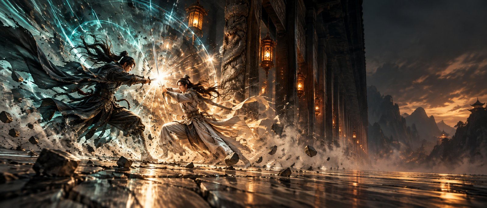
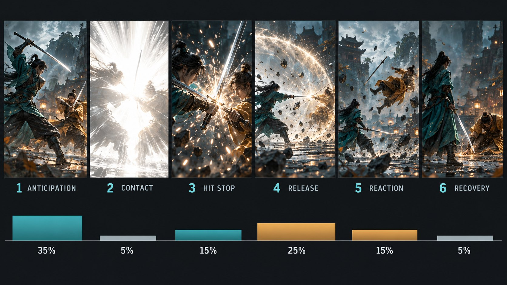
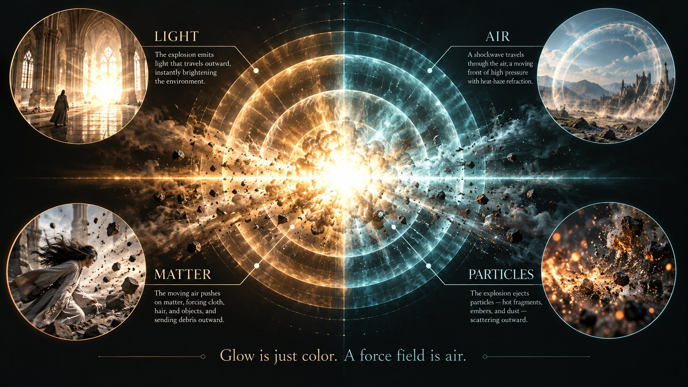
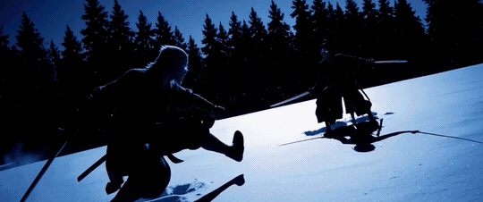
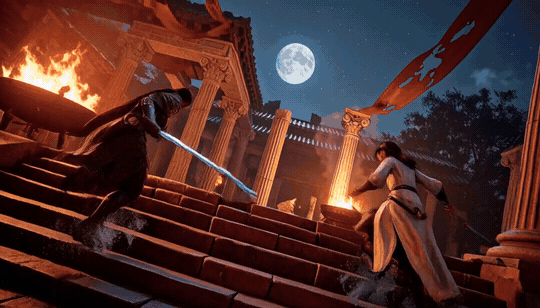
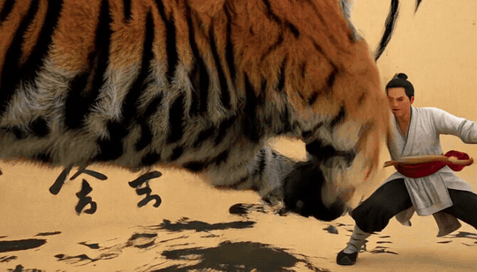
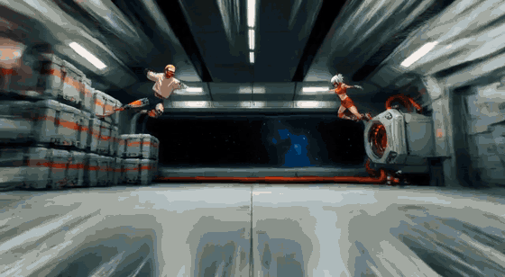
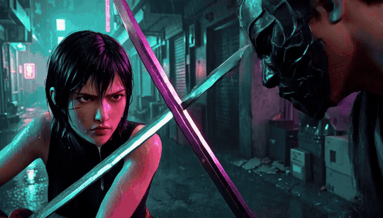
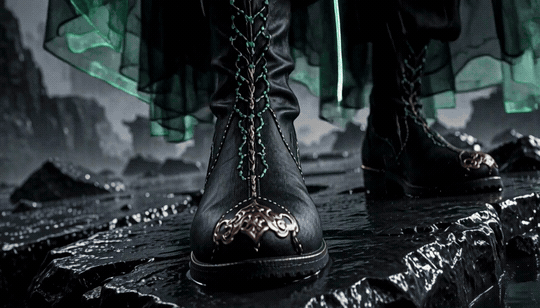

<p align="center">
  
</p>

<h1 align="center">h3-combat-impact</h1>

<p align="center">
  <b>End-to-end Agent Skill (v4.0) for high-impact MiniMax H3 / Hailuo combat: dual-track activation with an interactive director review gate, fight-directing contract, bilingual Ref2VA sync, <code>PRISM + SelfLiftH3Sampler</code> anti-blur rendering, <code>ComfyUI-Dials</code> dual-rail steering, and quantitative QA.</b>
</p>

<p align="center">
  <b>English</b> · <a href="README.zh-TW.md">繁體中文</a>
</p>

<p align="center">
  <a href="LICENSE"></a>
  
  
  
  
</p>

---

## v3.0 Flagship Showcase (`PRISM + SelfLift 14-step + Dials P8/P9`)

Generated at 1344×768 (15 s, 24 fps) via `scripts/render_comfy.py --engine selflift` and upscaled 2× to 2688×1536 (2K) with `ReCaVSR` from single-subject Krea 2 references:

<table>
  <tr>
    <td align="center" width="50%">
      <br>
      <b>Crimson vs Frost Rain-Night Duel (<code>P9</code>)</b><br>
      <sub>5-act causality, 180° axis lock, sharpness <b>208.6</b>, longest lull <b>0.00 s</b> · <a href="examples/v3-manju/orig01_v13_crimson_frost_blade_duel.txt">bilingual prompt</a></sub>
    </td>
    <td align="center" width="50%">
      <br>
      <b>Myriad Swords → Valley Shockwave Cannon (<code>P8</code>)</b><br>
      <sub><code>--anchor 0:4:-0.65</code> zero ground-slide, locked aerial cannon detonation, sharpness <b>417.4</b> · <a href="examples/v3-manju/rep04_v4_myriad_swords_cannon.txt">bilingual prompt</a></sub>
    </td>
  </tr>
</table>

---

## v4.0 Dual-Track Activation & Interactive Director Review

In v4.0 the skill decides for itself whether to stop and ask you anything. Once it is installed there are no commands to memorize: in everyday chat it enhances your fight prompts silently in the background. It switches to an interactive director only when you call it by name, ask how it works, or bring a half-formed idea — and in that mode you see and approve the choreography before any GPU time is spent.

| | **Track A · Silent auto-enhance** | **Track B · Interactive staged director** |
|---|---|---|
| Triggered when | You ask for a prompt or video involving fights, wuxia/xianxia, blades, monsters/mecha, aura bursts, shockwaves, ultimates or high-speed chases, **with characters, scene and action already clear**, and you don't name the skill | ① You name `h3-combat-impact` or say "use the combat skill to design…" ② You ask how the skill works or what it can do ③ You only drop reference images or a vague idea ("make me a cool fight") |
| What you see | No menus, no process talk — you get the bilingual prompt plus a suggested render command | A three-stage conversation that pauses at stage 2 for your approval |
| Under the hood | Duration routing, fact ledger, 9 combat carriers, posture–displacement anti-slip law, A-tier calm micro-expressions, anti-breakup body-mechanics phrasing, 1:1 bilingual cut sync, `validate_prompt.py` | Same checks as Track A, but each result is shown to you first |
| Starts the GPU? | No — the command is attached, not run | Never before the review gate passes: no long English prompt, no render |

**Track B in three stages**

```text
Stage 1 · Four quick questions   Combat type & carrier / duration & pacing density /
(recommended defaults, one-tap)  key spectacle, VFX & outcome / available assets & delivery
                                 → e.g. "1-A 2-B 3 as recommended 4-B" or "all recommended"

Stage 2 · Mandatory review gate  Delivers a "Video Content & Timeline Action Outline": seconds, moves,
(never skipped)                  aura VFX and who wins per segment
                                 → "Shall I proceed with this outline, or would you change any seconds,
                                    moves, aura effects or the outcome?"

Stage 3 · Compile & render       Only after approval: compile the Chinese director draft + English H3
                                 6-field prompt, run validate_prompt.py --check-sync to 0 FAIL,
                                 then deliver or call render_comfy.py
```

- Named the skill but the brief is already complete: still Track B — stage 1 collapses into a one-line confirmation, and **the stage-2 gate still applies**.
- "You decide" / "all recommended": stage 1 takes every default, but the flow still stops at stage 2.
- Only an explicit "skip the outline, just render it" switches to Track A.

Full scripts, option tables and the outline template: [`references/interactive-director-flow.md`](references/interactive-director-flow.md) (Traditional Chinese).

---

## What's New in v3.0

Beyond prompt craft, **v3.0** closes the loop from **upstream fight direction → local ComfyUI anti-blur rendering → quantitative motion, sharpness & foot-slip QA**:

1. **Anti-Blur `PRISM + SelfLiftH3Sampler` Pipeline (`16.5×` Sharper)** — Replaces 6-step Pika LCM smears with 14-step Euler `SelfLiftH3Sampler` (`lowres_scale=0.6`, `transition=6`, `h3_upscaler_lms_v0.1`) + optional `ReCaVSR 2×` (2688×1536 2K). Same seed, same prompt, same references: median Laplacian sharpness jumps from **10.9 → 179.8** (`p10` worst 10% frames **5.4 → 127.2**, `23.6×`) while running faster (**310 s vs 330 s** on RTX 5070 Ti 16 GB).
2. **`ComfyUI-Dials` Dual-Rail Steering & Motion-Leakage Calibration (`P1–P9`)** — Measured 5376-D `token_refiner` projections reveal `h3_storm` leaks `+0.375` effective motion per `+1.0` (causing "ground-skiing" if stacked unchecked). v3.0 introduces separate positive/negative `0..1` rails (`--anchor` ground pinning / `--burst` strike acceleration / `--hitstop` 0.25 s impact freeze), low-res/hi-res decoupling (`--hires-dials phase-motion | off`), and the verified **`P9` five-dial blade-duel preset** (sharpness **208.6**, longest lull **0.00 s**).
3. **Upstream Fight-Directing Contract & Anti-Grimace Facial Lock** — Enforces 180° screen-axis lock with contrasting dual-hue weapon arcs, 9 combat carriers, 15 s 5-beat / ≤10 s 4-beat continuity, posture–displacement compatibility (no kneeling + sprint verbs), **A-tier Anti-Grimace Lock** for stylized anime/donghua faces, and **single-subject plain-backdrop references** (preventing quad-view sheet leaks).
4. **Bilingual Sync & Expanded QA Scripts** — Outputs paired Chinese director draft + official English H3 6-field prompt checked via `validate_prompt.py --check-sync`, plus `measure_motion.py --fps24 --symmetry --footplant` and `measure_sharpness.py`.

---

## Quick Start (3 Steps)

### 1. Install the Skill

```bash
git clone https://github.com/ayase0307/h3-combat-impact ~/.claude/skills/h3-combat-impact
```

Works with any agent that reads `SKILL.md` (Claude Code, Codex, Antigravity, etc.). On Windows, clone into `%USERPROFILE%\.claude\skills\`.

Prompt in plain language:

> *"Direct a 15-second rain-night duel between a crimson-blade swordswoman and a frost-blade swordsman with clear victory/defeat."*
> *"Break down this reference fight clip and recreate it with PRISM + SelfLift + ComfyUI-Dials."*
> *"Design a 15-second myriad-swords shockwave cannon ultimate with zero foot-sliding."*

### 2. Validate Prompt Structure, Bilingual Cut Sync & Anti-Slip Rules

```bash
# Official H3 schema + bilingual cut-timestamp sync + aesthetic face check
python scripts/validate_prompt.py examples/v3-manju/orig01_v13_crimson_frost_blade_duel.txt --duration 15 --check-sync

# Run the full regression suite (28 / 28 passing: good samples = 0 FAIL, bad fixtures >= 1 FAIL)
python -m unittest discover -s tests -v
```

### 3. Render Locally on ComfyUI & Measure Results

```bash
# Dry-run graph & dial rack verification (no GPU required)
python scripts/render_comfy.py --engine selflift --preset P9 --hires-dials off \
  --prompt examples/v3-manju/orig01_v13_crimson_frost_blade_duel.txt \
  --ref hero.png --ref villain.png --ref scene.png \
  --seconds 15 --seed 7101 --stage final --job duel_p9 --out out/duel_p9.mp4 --dry

# Production 15 s 768p render (PRISM_int8 + DMAD 0.8 + SelfLift 14-step Euler)
python scripts/render_comfy.py --engine selflift \
  --unet Minimax-h3_Singularity_x_10Eros-Max_PRISM_int8.safetensors --dmad 0.8 \
  --scheduler simple --steps 14 --transition 6 --lowres-scale 0.6 --chunks 4 \
  --hires-dials off --preset P9 \
  --prompt examples/v3-manju/orig01_v13_crimson_frost_blade_duel.txt \
  --ref hero.png --ref villain.png --ref scene.png \
  --seconds 15 --seed 7101 --stage final --job duel_p9 --out out/duel_p9.mp4

# Optional 2x upscale to 2688x1536 (2K) via ReCaVSR while preserving audio
python scripts/render_comfy.py --stage upscale --seconds 15 \
  --input-video out/duel_p9.mp4 --job duel_p9_2k --out out/duel_p9_2k.mp4

# Quantitative QA: 24fps motion, symmetry, foot-slip, and Laplacian sharpness
python scripts/measure_motion.py out/duel_p9.mp4 --fps24 --symmetry --footplant
python scripts/measure_sharpness.py out/duel_p9.mp4
```

---

## v3.0 Controlled Engine & Dial Benchmarks

Fixed seed (`5002`), identical 8 s 1344×768 Ref2VA prompt & single-subject references on local RTX 5070 Ti (16 GB):

| Pipeline | Time | 24fps Motion | Sharpness (median) | Worst 10% (`p10`) | Facial Fidelity |
|---|---:|---:|---:|---:|---|
| Legacy Pika 6-step LCM | 330 s | 21.89 | 10.9 | 5.4 | Motion-blurred |
| `PRISM_int8` + DMAD 0.8 + SelfLift 12s (`hires-dials=keep`) | 410 s | 33.99 | 177.9 | 110.9 | Over-pushed grimace in hi-res |
| **`PRISM_int8` + DMAD 0.8 + SelfLift 14s (`hires-dials=off`)** | **310 s** | **34.71** | **179.8 (16.5×)** | **127.2 (23.6×)** | **Clean locked beauty** |
| `PRISM_DMAD_PDMD_int8` (`dmad=0`) + SelfLift 10s (`off`) | **200 s** | 34.01 | 106.5 (9.8×) | 75.9 (14.1×) | Fast preview / punchy impact |

### v3.0 Preset Routing (`--preset`)

| Preset | Best For | Key Dials & Strategy |
|---|---|---|
| **`P9`** | **High-intensity blade duels (flagship)** | `motion +0.50`, `ink_wash +0.50`, `storm +0.50`, `dramatic_light +0.90`, `silentfilm_cyberpunk +0.40`, `impact_frame +0.35` + `--hires-dials off` (`orig01_v13`: sharpness **208.6**, lull **0.00 s**) |
| **`P8`** | **Stationary cast → sky-splitting ultimate** | `dramatic_light +1.40`, `storm +0.80`, `evil_dread +0.55` + `--anchor 0:4:-0.65` (zero ground-slide) + `--burst 9:15:0.80` (`rep04_v4`: sharpness **417.4**) |
| **`P7`** | **Unarmed / hybrid close-quarters combat** | `dramatic_light +1.35`, `storm +0.85`, `evil_dread +0.45` + phase rails (`--anchor` / `--burst` / `--hitstop`) + `--hires-dials phase-motion` |
| **`P1–P4`** | Clear sparring / continuous chase / heavy strikes / giant boss | Motion-leakage calibrated (`P2` net $M_{\text{eff}} = +0.925$) |
| **`P5–P6`** | Temporary rune seals / brief space warp | Auto-zeroed at 75–80% timeline; avoid on straight energy cannons or melee |

---

## Anti-Breakup Field Test (Sulphur-3 / Corrector / Motion-STG)

On 2026-11-26 we grafted components of the community model Sulphur-3 onto this pipeline and ran a controlled A/B of 13 clips on an 8 s 768p sword-duel script (8 arms on seed 5002, 5 re-run on seed 5003; RTX 5070 Ti 16 GB):

| Component | Time | Motion | Verdict |
|---|---:|---:|---|
| Baseline: `PRISM_int8` + DMAD 0.8 + SelfLift 14-step | 251 s | 32.88 | **Kept as the default champion** |
| `s3_corrector` on both passes (bf16) | **+92%** | −13 to −14% | Off: ~30% softer in a near-paired comparison, reproduced on both seeds |
| `s3_corrector` on the low-res pass only | +20% | −3 to −4% | Off by default: within noise |
| Sulphur-3 Ref2VA hybrid base | +8% | **−36 to −37%** | Not for fight shots: it looks cleaner because it falls back to wide, posed framing, and still duplicates blades in the disarm |
| `--motion-stg` (bundled `comfy_nodes/` node) | +28% | +4% | The only arm that kept motion and the scripted disarm, but on a single seed — a re-test candidate, not a recommendation |

- No arm clearly removed melting or extra blades. The finding is "no visible improvement", not "proven ineffective".
- The ~30% softening comes from a near-paired comparison confounded by a low-res-pass precision difference and pose differences.
- The Sulphur-3 main model `s3.safetensors` is T2VA and cannot lock faces from multiple references, so it was not tested.

Full data, frame-by-frame review and limitations: [`docs/research/2026-11-26-sulphur3-anti-artifact-study.md`](docs/research/2026-11-26-sulphur3-anti-artifact-study.md) (Traditional Chinese).

---

## System Specs, Workflow Setup & Required Plugins

**Development & benchmark rig**: NVIDIA GeForce RTX 5070 Ti (16 GB GDDR7, driver 610.88) · Intel Core i5-14600KF · 96 GB DDR5 · Windows 11 Pro · ComfyUI 0.45.3 (Python 3.12+ / PyTorch CUDA). Tuning advice for 8 / 12 / 24 GB cards is in the VRAM tier table of the setup manual.

### Core weights (under `<ComfyUI>/models/`)

| Type | File | Subfolder | Source |
|---|---|---|---|
| Base model | `Minimax-h3_Singularity_x_10Eros-Max_PRISM_int8.safetensors` | `diffusion_models/` | Community [OliviaRossi/…PRISM](https://huggingface.co/OliviaRossi/Minimax-h3_Singularity-x-10Eros-Max_PRISM) |
| Text encoder | `qwen3vl_32b_minimax_h3_nvfp4_awq.safetensors` | `text_encoders/` | Official repack [Comfy-Org/MiniMax-H3](https://huggingface.co/Comfy-Org/MiniMax-H3) |
| Video / audio VAE | `minimax_h3_video_vae_int8_convrot` / `minimax_h3_audio_vae_fp32` | `vae/` | Same as above |
| Distillation LoRA | DMAD (`--dmad 0.8`; the default filename is a local merge) | `loras/` | Researcher release [ZhengmingYu/DMAD](https://huggingface.co/ZhengmingYu/DMAD), `_comfyui` files |
| Dials | 19 main dials + `experimental/` (used by P9) | `loras/dials/` | [MATLOWAI/H3-Dials](https://huggingface.co/MATLOWAI/H3-Dials) |
| Latent upscaler | `h3_upscaler_lms_v0.1` (local file; swap in a public one with `--upscaler`) | `latent_upscale_models/` | [LBH-123-AI/Minimax_h3_latent_Upscaler](https://huggingface.co/LBH-123-AI/Minimax_h3_latent_Upscaler) |
| Pixel upscaler | `transformer_int8_convrot.safetensors` | `recavsr/` | Community [PedroMarinhoDev/ReCaVSR-ComfyUI](https://huggingface.co/PedroMarinhoDev/ReCaVSR-ComfyUI) |

### Required ComfyUI plugins

| Plugin | Nodes provided |
|---|---|
| [facok/comfyui-SelfLift](https://github.com/facok/comfyui-SelfLift) | `SelfLiftH3Sampler` |
| [matlowai/ComfyUI-MAINodes](https://github.com/matlowai/ComfyUI-MAINodes) | `MAIDialRack`, `MAIDialHoldMap` |
| [kijai/ComfyUI-KJNodes](https://github.com/kijai/ComfyUI-KJNodes) | `MiniMaxChunkFeedForward` |
| [Kosinkadink/ComfyUI-VideoHelperSuite](https://github.com/Kosinkadink/ComfyUI-VideoHelperSuite) | `VHS_VideoCombine` |
| [PedroMarinhoDev/ComfyUI-ReCaVSR](https://github.com/PedroMarinhoDev/ComfyUI-ReCaVSR) | `ReCaVSRLoader`, `ReCaVSRUpscale` (2K upscale pass) |

`BlockSparseAttention` (sol-attn), `MiniMaxH3SigmaShift` and `MiniMaxH3ReferenceToVideo` are built into ComfyUI; `kijai/ComfyUI-SolAttn_triton` is deprecated by its author and not needed. [matlowai/ComfyUI-Dials](https://github.com/matlowai/ComfyUI-Dials) is the original stable dial release and shares the same dial files with MAINodes — install it only if you want to build your own dials.

### Further reading

- [`docs/setup-and-environment.md`](docs/setup-and-environment.md): full hardware specs, VRAM tiers, path and source for every weight, a Mermaid node-flow diagram, key node parameters, optional plugins and a one-shot `git clone` script (Traditional Chinese).
- [`workflows/`](workflows/): three API workflows exported from `render_comfy.py` (P9 Ref2VA, P8 dual-rail, ReCaVSR 2K), ready to `POST /prompt` or to read as a node-wiring reference.
- [`docs/verified-ecosystem-links.json`](docs/verified-ecosystem-links.json): links, licenses and verification snapshot for 12 plugins and 9 model repos.

---

## Four Combat & Skill Reference Libraries (125 Moves & Shot Assets)

Before writing a fight, decide which library each shot's action comes from. The four don't overlap: lay the foundation with `move-library.md`, then pull specialist material from the other three.

| Library | Contents | Use it for |
|---|---|---|
| [`move-library.md`](references/move-library.md) | **16** general-purpose moves (plus 4 chaining recipes and 3 round-structure rules) | The starting point for any fight: lunges, low attacks, strikes, blade paths, landings, energy release |
| [`martial-arts-compendium.md`](references/martial-arts-compendium.md) | **37** style-sourced techniques and exotic weapons | Bajiquan, Wing Chun, Baguazhang, Tai Chi, Xingyiquan, Muay Thai, judo/MMA real throws, iaijutsu, spear & staff, chain-sickle, twin iron fans, nine-section whip |
| [`manju-signature-tropes.md`](references/manju-signature-tropes.md) | **42** wuxia / xianxia / AI-manju signature tropes (including 4 ready-made 15 s five-beat director packages) | Realm-pressure hooks in the first 3 s, myriad-swords and dharma-avatar ultimates, aura clash reversals |
| [`unique-skills-and-sakuga.md`](references/unique-skills-and-sakuga.md) | **30**: 16 mechanic-driven powers + 14 Japanese sakuga shot chains | Space folding, shadow-pinning, time-stop colour drain; fisheye punches, speed-line tracking, inverted flash frames |

16 + 37 + 42 + 30 = **125** (the 4 chaining recipes are not counted). Shared rules across all four: English H3 lines describe only body mechanics, contact points and physical results — never literal move names, style names or animator names; zero negation words; throws need a lift-off arc and a ground-impact result.

---

## Core Design Principles

### The Six Beats

<p align="center">
  <br>
  <sub>One strike, six beats, and the share of time each one gets. No wind-up, no weight.</sub>
</p>

| Beat | Share | What the frame needs | Prompt key phrase |
|---|---:|---|---|
| 1 Anticipation | 35% | counter-motion, weight sinks, cloth tightens | `weight sinks into the rear leg` |
| 2 Contact | 5% | **impact frame**: 1–2 frames of white-out / black-out | `for two frames the entire frame blows out to pure white` |
| 3 Hit stop | 15% | time almost freezes, dust and sparks hang | `decelerates to a near-freeze for two frames` |
| 4 Release | 25% | shockwave, debris, dust ring, light shift | `a ring of shockwave dust bursts outward` |
| 5 Reaction | 15% | defender hurled back, delayed cloth and hair, **decaying shake** | `the shake decays within a third of a second` |
| 6 Recovery | 5% | back to guard, embers fall, camera steadies | `settles into a low guard` |

Anticipation ≥ 5× contact; one visual climax per hit. For non-stop brawls use the four-beat mode ([`continuous-brawl.md`](references/continuous-brawl.md)); for relentless cutting use [`ultra-speed.md`](references/ultra-speed.md).

### Force Field: Glow Is Just Colour

<p align="center">
  <br>
  <sub>Open at most three channels per hit. Priority: air &gt; matter &gt; light &gt; particles.</sub>
</p>

```text
✗  epic explosion, glowing shockwave
✓  wind pressure flattens the silk against her body, the air ripples in a heat-haze ring,
   roof tiles rattle loose
```

---

## Showcase (v4.0 Upgraded Reruns & Classic Clips)

Seven core clips below were upgraded in v4.0 on `PRISM_int8 + SelfLift 14-step + ComfyUI-Dials` dual rails at **1344×768 HD** (**1536×640** for 21:9; before/after metrics in [`2026-11-26-public-showcase-reruns.md`](docs/research/2026-11-26-public-showcase-reruns.md)). Click any title for the full MP4 with audio.

<table>
  <tr>
    <td align="center" width="50%">
      <a href="assets/showcase/blade-light.mp4"></a><br>
      <b><a href="assets/showcase/blade-light.mp4">21:9 blade-light (v4.0 P9)</a></b><br>
      <sub>1536×640 snow silhouettes, low sweep, grapple throw &amp; dual-hue arcs · <a href="examples/v4-showcase/blade-light-21x9-v4.txt">v4 prompt</a> · <a href="examples/blade-light-21x9.txt">v1</a></sub>
    </td>
    <td align="center" width="50%">
      <a href="assets/showcase/ultra-speed.mp4"></a><br>
      <b><a href="assets/showcase/ultra-speed.mp4">Ultra-speed, drone-style camera (v4.0 P7)</a></b><br>
      <sub>1344×768 12 shots in 8 s, dual-rail burst + close-up face anchor · <a href="examples/v4-showcase/ultra-speed-drone-v4.txt">v4 prompt</a> · <a href="examples/ultra-speed-drone.txt">v1</a></sub>
    </td>
  </tr>
  <tr>
    <td align="center">
      <a href="assets/showcase/ink-wash.mp4"></a><br>
      <b><a href="assets/showcase/ink-wash.mp4">Ink-wash burst (v4.0 ink dial)</a></b><br>
      <sub>1344×768 flexing ashwood spear + hitstop ink spikes · <a href="examples/v4-showcase/ink-wash-v4.txt">v4 prompt</a> · <a href="examples/ink-wash.txt">v1</a></sub>
    </td>
    <td align="center">
      <a href="assets/showcase/six-beat.mp4"></a><br>
      <b><a href="assets/showcase/six-beat.mp4">Six-beat single strike (v4.0 P7 hitstop)</a></b><br>
      <sub>1344×768 grounded advance, white-out hitstop &amp; shattering tiles · <a href="examples/six-beat-single-hit.txt">prompt</a></sub>
    </td>
  </tr>
  <tr>
    <td align="center">
      <a href="assets/showcase/anime-30s.mp4"></a><br>
      <b><a href="assets/showcase/anime-30s.mp4">30 s 2D-anime brawl from two reference images</a></b><br>
      <sub>2 × 15 s Ref2VA, identity-locked · <a href="examples/anime-ref2va-part1.txt">part 1</a> · <a href="examples/anime-ref2va-part2.txt">part 2</a></sub>
    </td>
    <td align="center">
      <a href="assets/showcase/face.mp4"></a><br>
      <b><a href="assets/showcase/face.mp4">Facial performance (v4.0 SelfLift)</a></b><br>
      <sub>1344×768 4-stage facial muscle transition &amp; hip-driven mask cleave · <a href="examples/v4-showcase/facial-performance-v4.txt">v4 prompt</a> · <a href="examples/facial-performance.txt">v1</a></sub>
    </td>
  </tr>
  <tr>
    <td align="center">
      <a href="assets/showcase/character-bloodmoon.mp4"></a><br>
      <b><a href="assets/showcase/character-bloodmoon.mp4">Character recreation A · Blood-moon maiden (v4.0 P8)</a></b><br>
      <sub>1344×768 Ref2VA: anchored regal push-in, star-spark snap &amp; asymmetric pillar · <a href="examples/v4-showcase/bloodmoon-ultimate-ref2va-v4.txt">v4 prompt</a> · <a href="examples/bloodmoon-ultimate-ref2va.txt">v1</a></sub>
    </td>
    <td align="center">
      <a href="assets/showcase/character-jade.mp4"></a><br>
      <b><a href="assets/showcase/character-jade.mp4">Character recreation B · Umbrella cultivator (v4.0 P8)</a></b><br>
      <sub>1344×768 Ref2VA: foreground parasol vs off-axis rift &amp; cubic stone slam · <a href="examples/v4-showcase/jade-rift-summon-ref2va-v4.txt">v4 prompt</a> · <a href="examples/jade-rift-summon-ref2va.txt">v1</a></sub>
    </td>
  </tr>
  <tr>
    <td align="center" colspan="2">
      <a href="assets/showcase/impact-inline.mp4"></a><br>
      <b><a href="assets/showcase/impact-inline.mp4">28 s impact-frame remake, cards written in the prompt</a></b><br>
      <sub>Nine H3 shots with inline hand-drawn impact cards · <a href="examples/impact-frame-screenplay.txt">prompt</a> · <a href="references/impact-frame-inline.md">how</a></sub>
    </td>
  </tr>
</table>

---

## Quantitative QA Thresholds

| Metric | Pass Bar | Tool / Flag |
|---|---|---|
| Opening 0.8 s motion | ≥ 50% of middle | `measure_motion.py --fps24` |
| End 2 s ÷ middle | ≥ 60% | `measure_motion.py --fps24` |
| Longest lull | ≤ 0.8 s | `measure_motion.py --fps24` |
| Action peaks | ≥ 4 | `measure_motion.py --fps24` |
| Static symmetry / foot-slip | No climax symmetry; zero kneeling slide | `measure_motion.py --symmetry --footplant` |
| Sharpness (768p SelfLift) | Median ≥ 120, `p10` ≥ 60 | `measure_sharpness.py` |

> Thresholds are calibrated on 24 fps footage. Always pass `--fps24` when comparing 30 fps or pulldown 60 fps clips.

---

## Repository Map

### Core Skill & v3.0 Modules
| Path | Covers |
|---|---|
| [`SKILL.md`](SKILL.md) | Master agent entry point (v4.0): stage-0 dual-track routing plus the 4-stage workflow — routing, fight-directing contract, bilingual sync, SelfLift + Dials |
| [`references/interactive-director-flow.md`](references/interactive-director-flow.md) | v4.0 dual-track flow: Track A silent-enhance checklist, Track B three-stage scripts, and the timeline-outline template |
| [`references/fight-directing-contract.md`](references/fight-directing-contract.md) | 5-tier fact priority, zero-hallucination ledger, 9 carriers, 180° axis & dual-hue trails, anti-slip posture rules |
| [`references/comfyui-dials-guide.md`](references/comfyui-dials-guide.md) | 5376-D motion-leakage coefficients, 19-dial lookup, `P1–P9` presets, push-pull rails, SelfLift decoupling & De-rope |
| [`references/reverse-and-remix.md`](references/reverse-and-remix.md) | Original vs reference-breakdown dual entry, 1-recreate + 2-remix workflow, 3-stage sampling |
| [`references/facial-performance.md`](references/facial-performance.md) | A-tier Anti-Grimace Lock (stylized/donghua beauty) vs B-tier rugged muscle actions |
| [`references/ref-identity-lock.md`](references/ref-identity-lock.md) | 9 identity classes, 3-word material anchors, single-subject reference rule (no quad-view leaks) |

### Fight Craft, Camera & Continuity References
| Path | Covers |
|---|---|
| [`references/impact-design.md`](references/impact-design.md) / [`force-field.md`](references/force-field.md) | Six-beat anatomy, power tiers, 4-channel force fields |
| [`references/choreography.md`](references/choreography.md) / [`move-library.md`](references/move-library.md) | Blade-verb quotas, real throws vs locks, 3 heights, 16 named moves, and the four-library navigator |
| [`references/martial-arts-compendium.md`](references/martial-arts-compendium.md) / [`manju-signature-tropes.md`](references/manju-signature-tropes.md) / [`unique-skills-and-sakuga.md`](references/unique-skills-and-sakuga.md) | 37 style-sourced techniques & exotic weapons, 42 wuxia/xianxia/manju signature tropes, 16 mechanic-driven powers + 14 sakuga shot chains |
| [`references/continuous-brawl.md`](references/continuous-brawl.md) / [`ultra-speed.md`](references/ultra-speed.md) | Four-beat non-stop brawls & 10–14 shot ULTRA_SPEED cutting |
| [`references/camera-grammar.md`](references/camera-grammar.md) / [`cinematic-camera.md`](references/cinematic-camera.md) / [`drone-camera.md`](references/drone-camera.md) | Official camera syntax, speed/amplitude jumps, 8 drone positions |
| [`references/blade-light-cinema.md`](references/blade-light-cinema.md) / [`ultimate-move.md`](references/ultimate-move.md) / [`vfx-vocabulary.md`](references/vfx-vocabulary.md) | 21:9 blade cinema, asymmetric target-destroying ultimates, bilingual VFX lexicon |
| [`references/impact-frame-and-shake.md`](references/impact-frame-and-shake.md) / [`impact-frame-post.md`](references/impact-frame-post.md) / [`impact-frame-inline.md`](references/impact-frame-inline.md) | 4 impact-frame paths (Dial pulse, inline multi-card flash-cut, post composite, white-out), decaying camera shake |
| [`references/shot-five-part-combat.md`](references/shot-five-part-combat.md) / [`speed-acceleration.md`](references/speed-acceleration.md) / [`vfx-choreography.md`](references/vfx-choreography.md) / [`character-signature-skill.md`](references/character-signature-skill.md) | Five-part combat shots with weight transfer, 8-tier speed density, spatial VFX choreography & character signature skill recreation |
| [`references/segment-continuity.md`](references/segment-continuity.md) / [`fl2va-chain.md`](references/fl2va-chain.md) / [`monster-scale.md`](references/monster-scale.md) | Multi-segment 3-table engineering, seams, giant-monster scaling |
| [`references/formats.md`](references/formats.md) / [`output-format.md`](references/output-format.md) / [`screenplay-format.md`](references/screenplay-format.md) / [`prompt-templates.md`](references/prompt-templates.md) / [`guided-mode.md`](references/guided-mode.md) / [`qa-checklist.md`](references/qa-checklist.md) / [`remix-pika-route.md`](references/remix-pika-route.md) | Format decision matrix, official 3/6-field schemas, screenplay format, templates, QA & REMIX route |

### Examples, Tests & Scripts
| Path | Covers |
|---|---|
| [`examples/`](examples/) | v1 baseline prompts, [`v4-showcase/`](examples/v4-showcase/) upgraded public showcase prompts, [`fight-30s/`](examples/fight-30s/), [`v2-demo/`](examples/v2-demo/), and [`v3-manju/`](examples/v3-manju/) bilingual flagship scripts (`orig01_v13`, `rep04_v4`, etc.) |
| [`tests/`](tests/) | 28 tests: `test_validate.py` (22 — good prompts, v4 showcase prompts, bad fixtures, profiles, bilingual sync, aesthetic face guard, v3.0 strict-physics flagships, anti-breakup body mechanics, short-shot spin stacking & screenplay format) + `test_flagship_jobs.py` (6 — flagship JOBS dual-rail timings aligned to script cuts) |
| [`workflows/`](workflows/) | Three API-format workflows: [`h3_prism_selflift_p9_ref2va.json`](workflows/h3_prism_selflift_p9_ref2va.json), [`h3_prism_selflift_p8_dualrail.json`](workflows/h3_prism_selflift_p8_dualrail.json), [`h3_recavsr_2k_upscale.json`](workflows/h3_recavsr_2k_upscale.json) |
| [`comfy_nodes/`](comfy_nodes/) | Bundled custom node `ComfyUI-H3-SelfLift-MotionSTG` (experimental `--motion-stg` option) |
| [`docs/`](docs/) | [`setup-and-environment.md`](docs/setup-and-environment.md) setup manual (Traditional Chinese), [`verified-ecosystem-links.json`](docs/verified-ecosystem-links.json) link audit, [`research/`](docs/research/) study reports |
| [`scripts/`](scripts/) | `validate_prompt.py`, `render_comfy.py`, `render_v3_flagship.py`, `measure_motion.py`, `measure_sharpness.py`, `measure_staging.py`, `measure_light_event.py`, `impact_frame.py`, `seam_check.py`, `compare_clips.py`, `gen_krea2_assets.py` |

---

## Honest Limits

- Local benchmarks come from single-rig runs (RTX 4060 Ti 8 GB for v1; RTX 5070 Ti 16 GB for v3 SelfLift/PRISM) with fixed seeds — they are reproducible engineering evidence, not formal academic benchmarks.
- `measure_motion.py` scores pixel change rather than semantic action quality; always inspect dark/silhouette shots and foot contact by eye.
- Large rendered `.mp4` test batches (`analysis/`, `docs/research/runs/*.mp4`) and third-party reference videos are intentionally excluded from Git to keep the repository lightweight.
- MiniMax H3 has no negative-prompt field; every constraint is written as a positive visual action or steered via `MAIDialRack`.

## License

MIT
