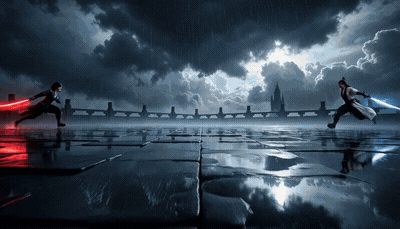
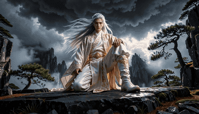
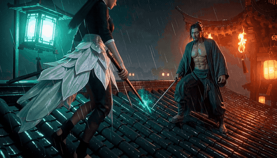
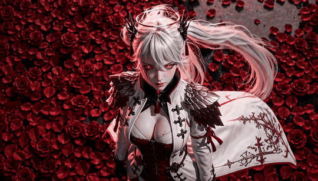
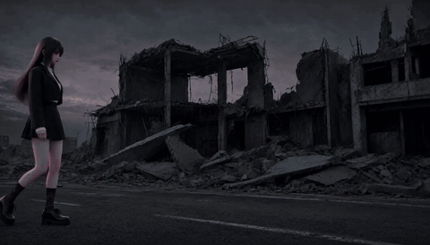

<p align="center">
  
</p>

<h1 align="center">h3-combat-impact</h1>

<p align="center">
  <b>End-to-end Agent Skill (v3.0) for high-impact MiniMax H3 / Hailuo combat: fight-directing contract, bilingual Ref2VA sync, <code>PRISM + SelfLiftH3Sampler</code> anti-blur rendering, <code>ComfyUI-Dials</code> dual-rail steering, and quantitative QA.</b>
</p>

<p align="center">
  <b>English</b> · <a href="README.zh-TW.md">繁體中文</a>
</p>

<p align="center">
  <a href="LICENSE"></a>
  
  
  
  
</p>

---

## v3.0 Flagship Showcase (`PRISM + SelfLift 14-step + Dials P8/P9`)

Generated at 1344×768 (15 s, 24 fps) via `scripts/render_comfy.py --engine selflift` and upscaled 2× to 2688×1536 (2K) with `ReCaVSR` from single-subject Krea 2 references:

<table>
  <tr>
    <td align="center" width="50%">
      <br>
      <b>Crimson vs Frost Rain-Night Duel (<code>P9</code>)</b><br>
      <sub>5-act causality, 180° axis lock, sharpness <b>208.6</b>, longest lull <b>0.00 s</b> · <a href="examples/v3-manju/orig01_v13_crimson_frost_blade_duel.txt">bilingual prompt</a></sub>
    </td>
    <td align="center" width="50%">
      <br>
      <b>Myriad Swords → Valley Shockwave Cannon (<code>P8</code>)</b><br>
      <sub><code>--anchor 0:4:-0.65</code> zero ground-slide, locked aerial cannon detonation, sharpness <b>417.4</b> · <a href="examples/v3-manju/rep04_v4_myriad_swords_cannon.txt">bilingual prompt</a></sub>
    </td>
  </tr>
</table>

---

## What's New in v3.0

Beyond prompt craft, **v3.0** closes the loop from **upstream fight direction → local ComfyUI anti-blur rendering → quantitative motion, sharpness & foot-slip QA**:

1. **Anti-Blur `PRISM + SelfLiftH3Sampler` Pipeline (`16.5×` Sharper)** — Replaces 6-step Pika LCM smears with 14-step Euler `SelfLiftH3Sampler` (`lowres_scale=0.6`, `transition=6`, `h3_upscaler_lms_v0.1`) + optional `ReCaVSR 2×` (2688×1536 2K). Same seed, same prompt, same references: median Laplacian sharpness jumps from **10.9 → 179.8** (`p10` worst 10% frames **5.4 → 127.2**, `23.6×`) while running faster (**310 s vs 330 s** on RTX 5070 Ti 16 GB).
2. **`ComfyUI-Dials` Dual-Rail Steering & Motion-Leakage Calibration (`P1–P9`)** — Measured 5376-D `token_refiner` projections reveal `h3_storm` leaks `+0.375` effective motion per `+1.0` (causing "ground-skiing" if stacked unchecked). v3.0 introduces separate positive/negative `0..1` rails (`--anchor` ground pinning / `--burst` strike acceleration / `--hitstop` 0.25 s impact freeze), low-res/hi-res decoupling (`--hires-dials phase-motion | off`), and the verified **`P9` five-dial blade-duel preset** (sharpness **208.6**, longest lull **0.00 s**).
3. **Upstream Fight-Directing Contract & Anti-Grimace Facial Lock** — Enforces 180° screen-axis lock with contrasting dual-hue weapon arcs, 9 combat carriers, 15 s 5-beat / ≤10 s 4-beat continuity, posture–displacement compatibility (no kneeling + sprint verbs), **A-tier Anti-Grimace Lock** for stylized anime/donghua faces, and **single-subject plain-backdrop references** (preventing quad-view sheet leaks).
4. **Bilingual Sync & Expanded QA Scripts** — Outputs paired Chinese director draft + official English H3 6-field prompt checked via `validate_prompt.py --check-sync`, plus `measure_motion.py --fps24 --symmetry --footplant` and `measure_sharpness.py`.

---

## Quick Start (3 Steps)

### 1. Install the Skill

```bash
git clone https://github.com/ayase0307/h3-combat-impact ~/.claude/skills/h3-combat-impact
```

Works with any agent that reads `SKILL.md` (Claude Code, Codex, Antigravity, etc.). On Windows, clone into `%USERPROFILE%\.claude\skills\`.

Prompt in plain language:

> *"Direct a 15-second rain-night duel between a crimson-blade swordswoman and a frost-blade swordsman with clear victory/defeat."*
> *"Break down this reference fight clip and recreate it with PRISM + SelfLift + ComfyUI-Dials."*
> *"Design a 15-second myriad-swords shockwave cannon ultimate with zero foot-sliding."*

### 2. Validate Prompt Structure, Bilingual Cut Sync & Anti-Slip Rules

```bash
# Official H3 schema + bilingual cut-timestamp sync + aesthetic face check
python scripts/validate_prompt.py examples/v3-manju/orig01_v13_crimson_frost_blade_duel.txt --duration 15 --check-sync

# Run regression test suite (good samples = 0 FAIL, bad fixtures >= 1 FAIL)
python -m unittest discover -s tests -v
```

### 3. Render Locally on ComfyUI & Measure Results

```bash
# Dry-run graph & dial rack verification (no GPU required)
python scripts/render_comfy.py --engine selflift --preset P9 --hires-dials off \
  --prompt examples/v3-manju/orig01_v13_crimson_frost_blade_duel.txt \
  --ref hero.png --ref villain.png --ref scene.png \
  --seconds 15 --seed 7101 --stage final --job duel_p9 --out out/duel_p9.mp4 --dry

# Production 15 s 768p render (PRISM_int8 + DMAD 0.8 + SelfLift 14-step Euler)
python scripts/render_comfy.py --engine selflift \
  --unet Minimax-h3_Singularity_x_10Eros-Max_PRISM_int8.safetensors --dmad 0.8 \
  --scheduler simple --steps 14 --transition 6 --lowres-scale 0.6 --chunks 4 \
  --hires-dials off --preset P9 \
  --prompt examples/v3-manju/orig01_v13_crimson_frost_blade_duel.txt \
  --ref hero.png --ref villain.png --ref scene.png \
  --seconds 15 --seed 7101 --stage final --job duel_p9 --out out/duel_p9.mp4

# Optional 2x upscale to 2688x1536 (2K) via ReCaVSR while preserving audio
python scripts/render_comfy.py --stage upscale --seconds 15 \
  --input-video out/duel_p9.mp4 --job duel_p9_2k --out out/duel_p9_2k.mp4

# Quantitative QA: 24fps motion, symmetry, foot-slip, and Laplacian sharpness
python scripts/measure_motion.py out/duel_p9.mp4 --fps24 --symmetry --footplant
python scripts/measure_sharpness.py out/duel_p9.mp4
```

---

## v3.0 Controlled Engine & Dial Benchmarks

Fixed seed (`5002`), identical 8 s 1344×768 Ref2VA prompt & single-subject references on local RTX 5070 Ti (16 GB):

| Pipeline | Time | 24fps Motion | Sharpness (median) | Worst 10% (`p10`) | Facial Fidelity |
|---|---:|---:|---:|---:|---|
| Legacy Pika 6-step LCM | 330 s | 21.89 | 10.9 | 5.4 | Motion-blurred |
| `PRISM_int8` + DMAD 0.8 + SelfLift 12s (`hires-dials=keep`) | 410 s | 33.99 | 177.9 | 110.9 | Over-pushed grimace in hi-res |
| **`PRISM_int8` + DMAD 0.8 + SelfLift 14s (`hires-dials=off`)** | **310 s** | **34.71** | **179.8 (16.5×)** | **127.2 (23.6×)** | **Clean locked beauty** |
| `PRISM_DMAD_PDMD_int8` (`dmad=0`) + SelfLift 10s (`off`) | **200 s** | 34.01 | 106.5 (9.8×) | 75.9 (14.1×) | Fast preview / punchy impact |

### v3.0 Preset Routing (`--preset`)

| Preset | Best For | Key Dials & Strategy |
|---|---|---|
| **`P9`** | **High-intensity blade duels (flagship)** | `motion +0.50`, `ink_wash +0.50`, `storm +0.50`, `dramatic_light +0.90`, `silentfilm_cyberpunk +0.40`, `impact_frame +0.35` + `--hires-dials off` (`orig01_v13`: sharpness **208.6**, lull **0.00 s**) |
| **`P8`** | **Stationary cast → sky-splitting ultimate** | `dramatic_light +1.40`, `storm +0.80`, `evil_dread +0.55` + `--anchor 0:4:-0.65` (zero ground-slide) + `--burst 9:15:0.80` (`rep04_v4`: sharpness **417.4**) |
| **`P7`** | **Unarmed / hybrid close-quarters combat** | `dramatic_light +1.35`, `storm +0.85`, `evil_dread +0.45` + phase rails (`--anchor` / `--burst` / `--hitstop`) + `--hires-dials phase-motion` |
| **`P1–P4`** | Clear sparring / continuous chase / heavy strikes / giant boss | Motion-leakage calibrated (`P2` net $M_{\text{eff}} = +0.925$) |
| **`P5–P6`** | Temporary rune seals / brief space warp | Auto-zeroed at 75–80% timeline; avoid on straight energy cannons or melee |

---

## Core Design Principles

### The Six Beats

<p align="center">
  <br>
  <sub>One strike, six beats, and the share of time each one gets. No wind-up, no weight.</sub>
</p>

| Beat | Share | What the frame needs | Prompt key phrase |
|---|---:|---|---|
| 1 Anticipation | 35% | counter-motion, weight sinks, cloth tightens | `weight sinks into the rear leg` |
| 2 Contact | 5% | **impact frame**: 1–2 frames of white-out / black-out | `for two frames the entire frame blows out to pure white` |
| 3 Hit stop | 15% | time almost freezes, dust and sparks hang | `decelerates to a near-freeze for two frames` |
| 4 Release | 25% | shockwave, debris, dust ring, light shift | `a ring of shockwave dust bursts outward` |
| 5 Reaction | 15% | defender hurled back, delayed cloth and hair, **decaying shake** | `the shake decays within a third of a second` |
| 6 Recovery | 5% | back to guard, embers fall, camera steadies | `settles into a low guard` |

Anticipation ≥ 5× contact; one visual climax per hit. For non-stop brawls use the four-beat mode ([`continuous-brawl.md`](references/continuous-brawl.md)); for relentless cutting use [`ultra-speed.md`](references/ultra-speed.md).

### Force Field: Glow Is Just Colour

<p align="center">
  <br>
  <sub>Open at most three channels per hit. Priority: air &gt; matter &gt; light &gt; particles.</sub>
</p>

```text
✗  epic explosion, glowing shockwave
✓  wind pressure flattens the silk against her body, the air ripples in a heat-haze ring,
   roof tiles rattle loose
```

---

## Showcase (v1 Baseline Clips)

Every clip below was generated on MiniMax H3 from [`examples/`](examples/) (fixed seed, 24 fps, 1280×704; 21:9 clip: 1280×544). Click any title for the MP4.

<table>
  <tr>
    <td align="center" width="50%">
      <a href="assets/showcase/blade-light.mp4"></a><br>
      <b><a href="assets/showcase/blade-light.mp4">21:9 blade-light</a></b><br>
      <sub>Back-lit silhouettes on blue snow, one violet intruder colour · <a href="examples/blade-light-21x9.txt">prompt</a></sub>
    </td>
    <td align="center" width="50%">
      <a href="assets/showcase/ultra-speed.mp4"></a><br>
      <b><a href="assets/showcase/ultra-speed.mp4">Ultra-speed, drone-style camera</a></b><br>
      <sub>12 shots in 8 s, a new camera position every cut · <a href="examples/ultra-speed-drone.txt">prompt</a></sub>
    </td>
  </tr>
  <tr>
    <td align="center">
      <a href="assets/showcase/ink-wash.mp4"></a><br>
      <b><a href="assets/showcase/ink-wash.mp4">Ink-wash burst</a></b><br>
      <sub>Ink spikes plus a one-frame flip instead of a freeze · <a href="examples/ink-wash.txt">prompt</a></sub>
    </td>
    <td align="center">
      <a href="assets/showcase/six-beat.mp4"></a><br>
      <b><a href="assets/showcase/six-beat.mp4">Six-beat single strike</a></b><br>
      <sub>Wind-up, white-out, shockwave, knock-back · <a href="examples/six-beat-single-hit.txt">prompt</a></sub>
    </td>
  </tr>
  <tr>
    <td align="center">
      <a href="assets/showcase/anime-30s.mp4"></a><br>
      <b><a href="assets/showcase/anime-30s.mp4">30 s 2D-anime brawl from two reference images</a></b><br>
      <sub>2 × 15 s Ref2VA, identity-locked · <a href="examples/anime-ref2va-part1.txt">part 1</a> · <a href="examples/anime-ref2va-part2.txt">part 2</a></sub>
    </td>
    <td align="center">
      <a href="assets/showcase/face.mp4"></a><br>
      <b><a href="assets/showcase/face.mp4">Facial performance</a></b><br>
      <sub>Muscle actions, not adjectives · <a href="examples/facial-performance.txt">prompt</a></sub>
    </td>
  </tr>
  <tr>
    <td align="center">
      <a href="assets/showcase/character-bloodmoon.mp4"></a><br>
      <b><a href="assets/showcase/character-bloodmoon.mp4">Character recreation A · Blood-moon maiden</a></b><br>
      <sub>10 s Ref2VA from three self-made references · <a href="examples/bloodmoon-ultimate-ref2va.txt">prompt</a></sub>
    </td>
    <td align="center">
      <a href="assets/showcase/character-jade.mp4"></a><br>
      <b><a href="assets/showcase/character-jade.mp4">Character recreation B · Umbrella cultivator</a></b><br>
      <sub>10 s Ref2VA from three self-made references · <a href="examples/jade-rift-summon-ref2va.txt">prompt</a></sub>
    </td>
  </tr>
  <tr>
    <td align="center" colspan="2">
      <a href="assets/showcase/impact-inline.mp4"></a><br>
      <b><a href="assets/showcase/impact-inline.mp4">28 s impact-frame remake, cards written in the prompt</a></b><br>
      <sub>Nine H3 shots with inline hand-drawn impact cards · <a href="examples/impact-frame-screenplay.txt">prompt</a> · <a href="references/impact-frame-inline.md">how</a></sub>
    </td>
  </tr>
</table>

---

## Quantitative QA Thresholds

| Metric | Pass Bar | Tool / Flag |
|---|---|---|
| Opening 0.8 s motion | ≥ 50% of middle | `measure_motion.py --fps24` |
| End 2 s ÷ middle | ≥ 60% | `measure_motion.py --fps24` |
| Longest lull | ≤ 0.8 s | `measure_motion.py --fps24` |
| Action peaks | ≥ 4 | `measure_motion.py --fps24` |
| Static symmetry / foot-slip | No climax symmetry; zero kneeling slide | `measure_motion.py --symmetry --footplant` |
| Sharpness (768p SelfLift) | Median ≥ 120, `p10` ≥ 60 | `measure_sharpness.py` |

> Thresholds are calibrated on 24 fps footage. Always pass `--fps24` when comparing 30 fps or pulldown 60 fps clips.

---

## Repository Map

### Core Skill & v3.0 Modules
| Path | Covers |
|---|---|
| [`SKILL.md`](SKILL.md) | Master 4-stage agent workflow (v3.0): routing, fight-directing contract, bilingual sync, SelfLift + Dials |
| [`references/fight-directing-contract.md`](references/fight-directing-contract.md) | 5-tier fact priority, zero-hallucination ledger, 9 carriers, 180° axis & dual-hue trails, anti-slip posture rules |
| [`references/comfyui-dials-guide.md`](references/comfyui-dials-guide.md) | 5376-D motion-leakage coefficients, 19-dial lookup, `P1–P9` presets, push-pull rails, SelfLift decoupling & De-rope |
| [`references/reverse-and-remix.md`](references/reverse-and-remix.md) | Original vs reference-breakdown dual entry, 1-recreate + 2-remix workflow, 3-stage sampling |
| [`references/facial-performance.md`](references/facial-performance.md) | A-tier Anti-Grimace Lock (stylized/donghua beauty) vs B-tier rugged muscle actions |
| [`references/ref-identity-lock.md`](references/ref-identity-lock.md) | 9 identity classes, 3-word material anchors, single-subject reference rule (no quad-view leaks) |

### Fight Craft, Camera & Continuity References
| Path | Covers |
|---|---|
| [`references/impact-design.md`](references/impact-design.md) / [`force-field.md`](references/force-field.md) | Six-beat anatomy, power tiers, 4-channel force fields |
| [`references/choreography.md`](references/choreography.md) / [`move-library.md`](references/move-library.md) | Blade-verb quotas, real throws vs locks, 3 heights, 16 named moves |
| [`references/continuous-brawl.md`](references/continuous-brawl.md) / [`ultra-speed.md`](references/ultra-speed.md) | Four-beat non-stop brawls & 10–14 shot ULTRA_SPEED cutting |
| [`references/camera-grammar.md`](references/camera-grammar.md) / [`cinematic-camera.md`](references/cinematic-camera.md) / [`drone-camera.md`](references/drone-camera.md) | Official camera syntax, speed/amplitude jumps, 8 drone positions |
| [`references/blade-light-cinema.md`](references/blade-light-cinema.md) / [`ultimate-move.md`](references/ultimate-move.md) / [`vfx-vocabulary.md`](references/vfx-vocabulary.md) | 21:9 blade cinema, asymmetric target-destroying ultimates, bilingual VFX lexicon |
| [`references/impact-frame-and-shake.md`](references/impact-frame-and-shake.md) / [`impact-frame-post.md`](references/impact-frame-post.md) / [`impact-frame-inline.md`](references/impact-frame-inline.md) | 4 impact-frame paths (Dial pulse, inline multi-card flash-cut, post composite, white-out), decaying camera shake |
| [`references/shot-five-part-combat.md`](references/shot-five-part-combat.md) / [`speed-acceleration.md`](references/speed-acceleration.md) / [`vfx-choreography.md`](references/vfx-choreography.md) / [`character-signature-skill.md`](references/character-signature-skill.md) | Five-part combat shots with weight transfer, 8-tier speed density, spatial VFX choreography & character signature skill recreation |
| [`references/segment-continuity.md`](references/segment-continuity.md) / [`fl2va-chain.md`](references/fl2va-chain.md) / [`monster-scale.md`](references/monster-scale.md) | Multi-segment 3-table engineering, seams, giant-monster scaling |
| [`references/formats.md`](references/formats.md) / [`output-format.md`](references/output-format.md) / [`screenplay-format.md`](references/screenplay-format.md) / [`prompt-templates.md`](references/prompt-templates.md) / [`guided-mode.md`](references/guided-mode.md) / [`qa-checklist.md`](references/qa-checklist.md) / [`remix-pika-route.md`](references/remix-pika-route.md) | Format decision matrix, official 3/6-field schemas, screenplay format, templates, QA & REMIX route |

### Examples, Tests & Scripts
| Path | Covers |
|---|---|
| [`examples/`](examples/) | v1 baseline prompts, [`fight-30s/`](examples/fight-30s/), [`v2-demo/`](examples/v2-demo/), and [`v3-manju/`](examples/v3-manju/) bilingual flagship scripts (`orig01_v13`, `rep04_v4`, etc.) |
| [`tests/`](tests/) | `test_validate.py` (9 regression tests covering good prompts, bad fixtures, profiles, bilingual sync, aesthetic face guard & v3.0 strict-physics flagship scripts) |
| [`scripts/`](scripts/) | `validate_prompt.py`, `render_comfy.py`, `render_v3_flagship.py`, `measure_motion.py`, `measure_sharpness.py`, `measure_staging.py`, `measure_light_event.py`, `impact_frame.py`, `seam_check.py`, `compare_clips.py`, `gen_krea2_assets.py` |

---

## Honest Limits

- Local benchmarks come from single-rig runs (RTX 4060 Ti 8 GB for v1; RTX 5070 Ti 16 GB for v3 SelfLift/PRISM) with fixed seeds — they are reproducible engineering evidence, not formal academic benchmarks.
- `measure_motion.py` scores pixel change rather than semantic action quality; always inspect dark/silhouette shots and foot contact by eye.
- Large rendered `.mp4` test batches (`analysis/`, `docs/research/runs/*.mp4`) and third-party reference videos are intentionally excluded from Git to keep the repository lightweight.
- MiniMax H3 has no negative-prompt field; every constraint is written as a positive visual action or steered via `MAIDialRack`.

## License

MIT
