<p align="center">
  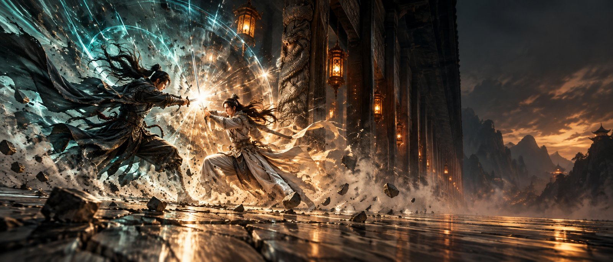
</p>

<h1 align="center">h3-combat-impact</h1>

<p align="center">
  <b>讓 MiniMax H3 / 海螺武戲「拳拳到肉、不糊不滑、不崩顏值」的完整 Agent Skill（v3.0）：上游導演合約、雙語 Ref2VA 同步、<code>PRISM + SelfLiftH3Sampler</code> 去模糊渲染、<code>ComfyUI-Dials</code> 正負雙軌調控與量化驗收。</b>
</p>

<p align="center">
  <a href="README.md">English</a> · <b>繁體中文</b>
</p>

<p align="center">
  <a href="LICENSE"></a>
  
  
  
  
</p>

---

## v3.0 旗艦成品展示（`PRISM + SelfLift 14 步 + Dials P8/P9`）

以下兩支皆由 `scripts/render_comfy.py --engine selflift`（15 秒、24 fps、1344×768）搭配單主體 Krea 2 參考圖出片，並以 `ReCaVSR 2×` 超分至 2688×1536（2K）：

<table>
  <tr>
    <td align="center" width="50%">
      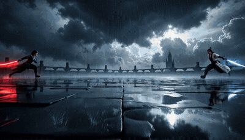<br>
      <b>雨夜雙色刀弧死鬥（<code>P9</code> 五滑塊王牌）</b><br>
      <sub>五幕完整因果、180° 軸線鎖死、清晰度 <b>208.6</b>、最長低潮 <b>0.00 s</b> · <a href="examples/v3-manju/orig01_v13_crimson_frost_blade_duel.txt">雙語劇本</a></sub>
    </td>
    <td align="center" width="50%">
      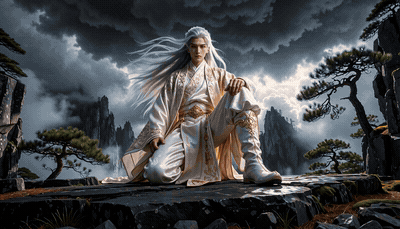<br>
      <b>萬劍歸宗 → 單向山谷衝擊波主砲（<code>P8</code> 相位雙軌）</b><br>
      <sub><code>--anchor 0:4:-0.65</code> 釘樁零滑行、固定全景單向爆破、清晰度 <b>417.4</b> · <a href="examples/v3-manju/rep04_v4_myriad_swords_cannon.txt">雙語劇本</a></sub>
    </td>
  </tr>
</table>

---

## v3.0 核心躍進

**v3.0** 不只教模型怎麼寫提示詞，更打通了「**上游導演編排 → 本機 ComfyUI 抗模糊出片 → 運動／清晰度／防滑量化驗收**」整條閉環：

1. **`PRISM + SelfLiftH3Sampler` 抗動態模糊管線（清晰度暴增 `16.5×`）** — 以 14 步 Euler `SelfLiftH3Sampler`（`lowres_scale=0.6`、`transition=6`、`h3_upscaler_lms_v0.1`）取代傳統 6 步 Pika LCM，並可串接 `ReCaVSR 2×` 直出 2688×1536 2K。同種子同素材實測：拉普拉斯清晰度中位數從 **10.9 → 179.8**，最糊 10% 幀從 **5.4 → 127.2（23.6×）**，耗時甚至更短（RTX 5070 Ti 16 GB：**310 秒 vs 330 秒**）。
2. **`ComfyUI-Dials` 正負雙軌調控與共線洩漏校準（`P1–P9`）** — 實測 5376 維 `token_refiner` 內積發現 `h3_storm` 每 `+1.0` 會偷加 `+0.375` 運動量（疊過頭會導致角色跪地滑行）。v3.0 建立獨立 `0..1` 正負雙軌（`--anchor` 釘樁防滑／`--burst` 交鋒加速／`--hitstop` 0.25s 卡肉頓幀）、一採／二採解耦（`--hires-dials phase-motion | off`），並推出實證王牌 **`P9` 五滑塊雙色刀弧配方**（清晰度 **208.6**、最長低潮 **0.00 s**）。
3. **上游導演合約＋A 檔美型臉冷靜壓制** — 鎖定 180° 軸線與對比色刀弧光軌、5 級事實優先級、9 大戰鬥載體路由、姿態—位移防滑律（跪／蹲禁配衝刺詞）、**A 檔冷靜微表情鎖（Anti-Grimace Lock）**防 3D 國漫／AI 漫劇特寫齜牙醜臉，以及**純灰底單主體參考圖紅線**（徹底根除四視圖拼板閃入）。
4. **雙語同步編譯與自動化 QA 腳本** — 預設同步交付「中文導演母稿＋H3 Ref2VA 英文六欄位」並由 `validate_prompt.py --check-sync` 鎖死切鏡秒數；成片以 `measure_motion.py --fps24 --symmetry --footplant` 與 `measure_sharpness.py` 客觀把關。

---

## 快速開始（三步驟）

### 1. 安裝 Skill

```bash
git clone https://github.com/ayase0307/h3-combat-impact ~/.claude/skills/h3-combat-impact
```

支援任何讀取 `SKILL.md` 的 Agent（Claude Code、Codex、Antigravity 等）。Windows 請 clone 至 `%USERPROFILE%\.claude\skills\`。

安裝後直接用白話下達導演需求：

> 「幫我導演一段 15 秒雨夜雙人刀劍死鬥，左女赤紅刀弧 vs 右男冰藍劍弧，要有明確勝負。」
> 「拆解這支打鬥參考片，用 PRISM + SelfLift + ComfyUI-Dials 復刻出 2K 成片。」
> 「設計一段 15 秒萬劍歸宗接單向山谷衝擊波大砲，前 4 秒穩跪不可滑行。」

### 2. 上游格式、雙語切點與防滑驗證

```bash
# 檢查官方 H3 結構、雙語時間碼同步、美型臉過激詞與招式多樣性（0 FAIL 才送渲染）
python scripts/validate_prompt.py examples/v3-manju/orig01_v13_crimson_frost_blade_duel.txt --duration 15 --check-sync

# 執行驗證器回歸測試（8 / 8 通過）
python -m unittest discover -s tests -v
```

### 3. 本機 ComfyUI 出片與量化驗收

```bash
# 只建圖驗證節點與 MAIDialRack 曲線（不佔 GPU）
python scripts/render_comfy.py --engine selflift --preset P9 --hires-dials off \
  --prompt examples/v3-manju/orig01_v13_crimson_frost_blade_duel.txt \
  --ref hero.png --ref villain.png --ref scene.png \
  --seconds 15 --seed 7101 --stage final --job duel_p9 --out out/duel_p9.mp4 --dry

# 正式出片：15 秒 768p（PRISM_int8 + DMAD 0.8 + SelfLift 14 步 Euler）
python scripts/render_comfy.py --engine selflift \
  --unet Minimax-h3_Singularity_x_10Eros-Max_PRISM_int8.safetensors --dmad 0.8 \
  --scheduler simple --steps 14 --transition 6 --lowres-scale 0.6 --chunks 4 \
  --hires-dials off --preset P9 \
  --prompt examples/v3-manju/orig01_v13_crimson_frost_blade_duel.txt \
  --ref hero.png --ref villain.png --ref scene.png \
  --seconds 15 --seed 7101 --stage final --job duel_p9 --out out/duel_p9.mp4

# 可選三採：ReCaVSR 2x 超分升至 2688×1536（2K，保留原音訊）
python scripts/render_comfy.py --stage upscale --seconds 15 \
  --input-video out/duel_p9.mp4 --job duel_p9_2k --out out/duel_p9_2k.mp4

# 量化驗收：24fps 運動節拍、靜止對稱、貼地滑行與清晰度
python scripts/measure_motion.py out/duel_p9.mp4 --fps24 --symmetry --footplant
python scripts/measure_sharpness.py out/duel_p9.mp4
```

---

## v3.0 引擎與滑塊受控實測

固定種子（`5002`）、相同 8 秒 1344×768 Ref2VA 劇本與單主體參考圖（RTX 5070 Ti 16 GB）：

| 出片管線 | 耗時 | 全程 24fps 運動 | 清晰度中位數 | 最糊 10% 幀 (`p10`) | 特寫顏值 |
|---|---:|---:|---:|---:|---|
| 舊版 Pika 6 步 LCM | 330 秒 | 21.89 | 10.9 | 5.4 | 高速動態糊化 |
| `PRISM_int8` + DMAD 0.8 + SelfLift 12s（`hires-dials=keep`） | 410 秒 | 33.99 | 177.9 | 110.9 | 二採高強 Dial 推成鬼臉 |
| **`PRISM_int8` + DMAD 0.8 + SelfLift 14s（`hires-dials=off`）** | **310 秒** | **34.71** | **179.8（16.5×）** | **127.2（23.6×）** | **100% 鎖住絕美顏值** |
| `PRISM_DMAD_PDMD_int8`（`dmad=0`）+ SelfLift 10s（`off`） | **200 秒** | 34.01 | 106.5（9.8×） | 75.9（14.1×） | 極速預覽／強衝擊幀 |

### v3.0 主力武戲配方速選（`--preset`）

| Preset | 適用場景 | 核心配方與調控策略 |
|---|---|---|
| **`P9`** | **雙人冷兵器高燃死鬥（王牌）** | `motion +0.50`、`ink_wash +0.50`、`storm +0.50`、`dramatic_light +0.90`、`silentfilm_cyberpunk +0.40`、`impact_frame +0.35` ＋ `--hires-dials off`（`orig01_v13` 清晰度 **208.6**、最長低潮 **0.00 s**） |
| **`P8`** | **定樁蓄勢 → 單向破空主砲大招** | `dramatic_light +1.40`、`storm +0.80`、`evil_dread +0.55` ＋ `--anchor 0:4:-0.65`（零滑行）＋ `--burst 9:15:0.80`（`rep04_v4` 清晰度 **417.4**） |
| **`P7`** | **雙人徒手／混合實戰** | `dramatic_light +1.35`、`storm +0.85`、`evil_dread +0.45` ＋正負雙軌（`--anchor`/`--burst`/`--hitstop`）＋ `--hires-dials phase-motion` |
| **`P1–P4`** | 純拆招／全程追逐／重擊／慢重巨獸 | 已完成 `storm` 運動洩漏校準（`P2` 淨 $M_{\text{eff}} = +0.925$） |
| **`P5–P6`** | 短暫結印法陣／瞬時空間扭曲 | 內建 75–80% 處強制歸零；直線光砲與近身肉搏禁用 |

---

## 核心武戲設計結構

### 六拍打擊

<p align="center">
  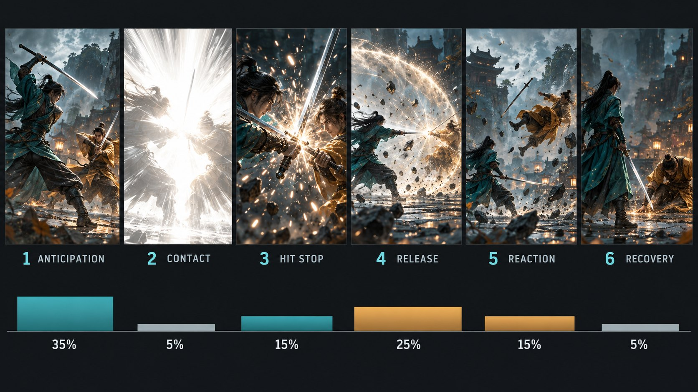<br>
  <sub>一擊六拍與各自的時間佔比。沒有蓄力，就沒有重量。</sub>
</p>

| 拍 | 佔比 | 畫面要有 | 提示詞關鍵句 |
|---|---:|---|---|
| 1 蓄 | 35% | 反向預備、重心下沉、布料繃緊 | `weight sinks into the rear leg` |
| 2 觸 | 5% | **衝擊幀**：1–2 幀爆白／爆黑 | `for two frames the entire frame blows out to pure white` |
| 3 停 | 15% | 時間近乎凍結，塵與火花懸浮 | `decelerates to a near-freeze for two frames` |
| 4 洩 | 25% | 衝擊波、碎片、塵環、光影聯動 | `a ring of shockwave dust bursts outward` |
| 5 退 | 15% | 受擊者被打飛、衣髮延遲甩動、**震屏衰減** | `the shake decays within a third of a second` |
| 6 收 | 5% | 回到防禦姿勢、餘燼飄落、鏡頭回穩 | `settles into a low guard` |

蓄 ≥ 觸的 5 倍；一擊只給一個視覺高潮。壓迫連打改用無凍結四拍（[`continuous-brawl.md`](references/continuous-brawl.md)），喘不過氣的高速快切改用 [`ultra-speed.md`](references/ultra-speed.md)。

### 力場：光效只是顏色，力場才是空氣

<p align="center">
  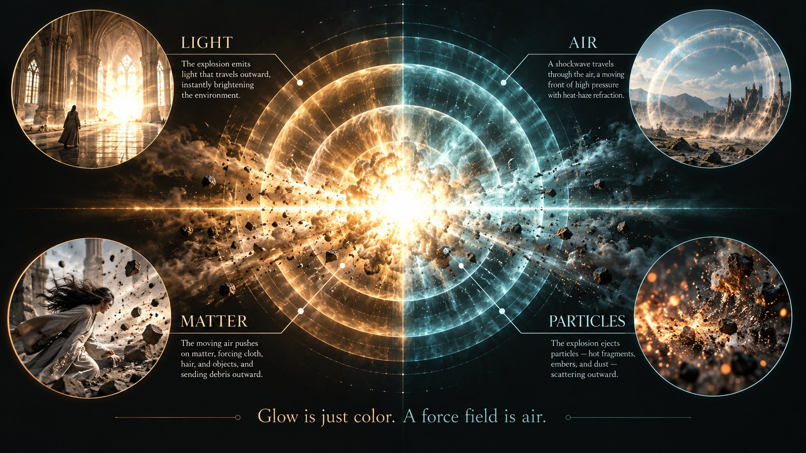<br>
  <sub>每擊最多同時開三個通道。優先順序：空氣 &gt; 物質 &gt; 光 &gt; 粒子。</sub>
</p>

```text
✗  epic explosion, glowing shockwave
✓  wind pressure flattens the silk against her body, the air ripples in a heat-haze ring,
   roof tiles rattle loose
```

---

## 成品展示（v1 基準片段）

以下片段皆以 [`examples/`](examples/) 提示詞生成（固定種子、24 fps、1280×704；21:9 片段為 1280×544）。點擊標題可開啟完整 MP4。

<table>
  <tr>
    <td align="center" width="50%">
      <a href="assets/showcase/blade-light.mp4">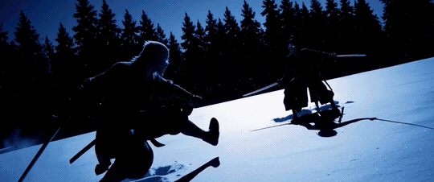</a><br>
      <b><a href="assets/showcase/blade-light.mp4">21:9 刃光電影</a></b><br>
      <sub>藍雪上的逆光剪影，唯一的紫色異物色 · <a href="examples/blade-light-21x9.txt">提示詞</a></sub>
    </td>
    <td align="center" width="50%">
      <a href="assets/showcase/ultra-speed.mp4">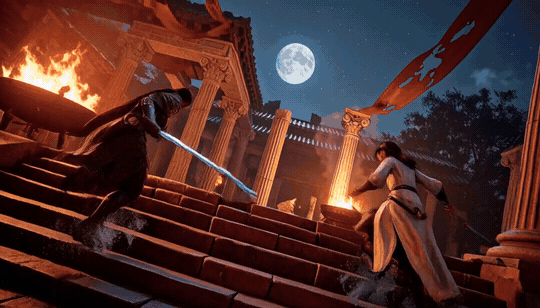</a><br>
      <b><a href="assets/showcase/ultra-speed.mp4">超高速・無人機式運鏡</a></b><br>
      <sub>8 秒 12 鏡，每次切鏡都換機位 · <a href="examples/ultra-speed-drone.txt">提示詞</a></sub>
    </td>
  </tr>
  <tr>
    <td align="center">
      <a href="assets/showcase/ink-wash.mp4">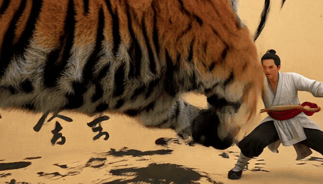</a><br>
      <b><a href="assets/showcase/ink-wash.mp4">水墨墨爆</a></b><br>
      <sub>用墨刺加 1 幀亮暗翻轉取代凍結 · <a href="examples/ink-wash.txt">提示詞</a></sub>
    </td>
    <td align="center">
      <a href="assets/showcase/six-beat.mp4">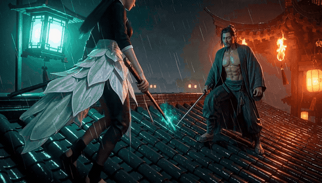</a><br>
      <b><a href="assets/showcase/six-beat.mp4">六拍單次重擊</a></b><br>
      <sub>蓄力、爆白、衝擊波、被打飛 · <a href="examples/six-beat-single-hit.txt">提示詞</a></sub>
    </td>
  </tr>
  <tr>
    <td align="center">
      <a href="assets/showcase/anime-30s.mp4">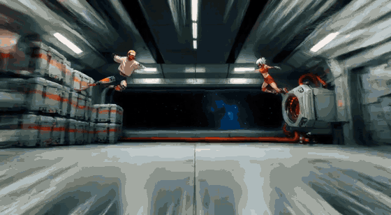</a><br>
      <b><a href="assets/showcase/anime-30s.mp4">兩張參考圖生成的 30 秒 2D 動漫格鬥</a></b><br>
      <sub>2 × 15 秒 Ref2VA，角色保真 · <a href="examples/anime-ref2va-part1.txt">上半</a> · <a href="examples/anime-ref2va-part2.txt">下半</a></sub>
    </td>
    <td align="center">
      <a href="assets/showcase/face.mp4">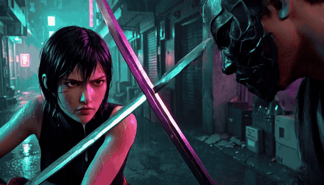</a><br>
      <b><a href="assets/showcase/face.mp4">臉部表演</a></b><br>
      <sub>寫肌肉動作，不寫形容詞 · <a href="examples/facial-performance.txt">提示詞</a></sub>
    </td>
  </tr>
  <tr>
    <td align="center" colspan="2">
      <a href="assets/showcase/impact-composite.mp4">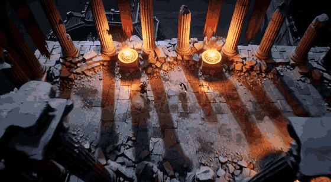</a><br>
      <b><a href="assets/showcase/impact-composite.mp4">後製加上衝擊幀</a></b><br>
      <sub>逐幀精準合成 3 × 2 漫畫衝擊序列 · <a href="references/impact-frame-post.md">做法</a></sub>
    </td>
  </tr>
</table>

---

## 量化驗收門檻

| 指標 | 合格門檻 | 腳本／參數 |
|---|---|---|
| 開場 0.8s 運動 | ≥ 中段 50% | `measure_motion.py --fps24` |
| 末 2s ÷ 中段 | ≥ 60% | `measure_motion.py --fps24` |
| 最長低潮 | ≤ 0.8s | `measure_motion.py --fps24` |
| 動作峰值格 | ≥ 4 | `measure_motion.py --fps24` |
| 靜止對稱／貼地滑行 | 高潮不出現靜止對稱；跪蹲零滑行 | `measure_motion.py --symmetry --footplant` |
| 清晰度（768p SelfLift） | 中位數 ≥ 120、`p10` ≥ 60 | `measure_sharpness.py` |

> 門檻以 24 fps 校準；比較 30 fps 或 2:3 pulldown 的 60 fps 影片前務必加 `--fps24`。

---

## 檔案一覽

### 核心技能與 v3.0 模組
| 檔案 | 內容 |
|---|---|
| [`SKILL.md`](SKILL.md) | 四階段 Agent 總入口（v3.0）：入口路由、導演合約、雙語同步、SelfLift ＋ Dials |
| [`references/fight-directing-contract.md`](references/fight-directing-contract.md) | 5 級事實優先級、零推斷帳本、9 載體路由、180° 軸線與雙色光軌、防滑步態合約 |
| [`references/comfyui-dials-guide.md`](references/comfyui-dials-guide.md) | 5376 維運動洩漏係數、19 轉盤速查、P1–P9 配方、正負雙軌、SelfLift 解耦與 De-rope |
| [`references/reverse-and-remix.md`](references/reverse-and-remix.md) | 原創／參考片逆向雙入口、1 復刻＋2 衍生並列抽卡、三段採樣流水線 |
| [`references/facial-performance.md`](references/facial-performance.md) | A 檔美型臉冷靜壓制（Anti-Grimace Lock）vs B 檔粗獷肌肉動作 |
| [`references/ref-identity-lock.md`](references/ref-identity-lock.md) | 9 類身份特徵、3 詞材質錨、單主體參考圖防四視圖洩漏紅線 |

### 打擊感、運鏡與多段連續性
| 檔案 | 內容 |
|---|---|
| [`references/impact-design.md`](references/impact-design.md) / [`force-field.md`](references/force-field.md) | 六拍細節、力度分級、力場四通道與句庫 |
| [`references/choreography.md`](references/choreography.md) / [`move-library.md`](references/move-library.md) | 招式配額制（刀路上限）、真摔判準、三高度、16 招具名庫 |
| [`references/continuous-brawl.md`](references/continuous-brawl.md) / [`ultra-speed.md`](references/ultra-speed.md) | 連續對轟四拍模式、8 秒 10–14 鏡 ULTRA_SPEED 快切 |
| [`references/camera-grammar.md`](references/camera-grammar.md) / [`cinematic-camera.md`](references/cinematic-camera.md) / [`drone-camera.md`](references/drone-camera.md) | 官方運鏡語法、三檔速度與幅度跳級、無人機 8 機位 |
| [`references/blade-light-cinema.md`](references/blade-light-cinema.md) / [`ultimate-move.md`](references/ultimate-move.md) / [`vfx-vocabulary.md`](references/vfx-vocabulary.md) | 21:9 刃光電影語言、有靶有傷的大招原型、中英特效與色彩腳本 |
| [`references/impact-frame-and-shake.md`](references/impact-frame-and-shake.md) / [`impact-frame-post.md`](references/impact-frame-post.md) | 衝擊幀四路徑（Dial 脈衝／後製合成／卡片／爆白）、震屏衰減 |
| [`references/segment-continuity.md`](references/segment-continuity.md) / [`fl2va-chain.md`](references/fl2va-chain.md) / [`monster-scale.md`](references/monster-scale.md) | 多段三表工程、接縫檢查、以小打大巨獸尺度參照 |
| [`references/formats.md`](references/formats.md) / [`output-format.md`](references/output-format.md) / [`screenplay-format.md`](references/screenplay-format.md) / [`prompt-templates.md`](references/prompt-templates.md) / [`guided-mode.md`](references/guided-mode.md) / [`qa-checklist.md`](references/qa-checklist.md) / [`remix-pika-route.md`](references/remix-pika-route.md) | 三格式決策表、官方三／六欄位契約、劇本式格式、填空模板、引導樹、QA 與 REMIX 路線 |

### 範例、測試與腳本
| 檔案 | 內容 |
|---|---|
| [`examples/`](examples/) | v1 基準範例、[`fight-30s/`](examples/fight-30s/)、[`v2-demo/`](examples/v2-demo/) 與 [`v3-manju/`](examples/v3-manju/) 雙語旗艦劇本（含 `orig01_v13`、`rep04_v4`） |
| [`tests/`](tests/) | `test_validate.py`（9 項回歸測試：好樣本、壞樣本、打法模式、雙語切點同步、美型臉防過激與 v3.0 嚴格物理旗艦劇本） |
| [`scripts/`](scripts/) | `validate_prompt.py`、`render_comfy.py`、`render_v3_flagship.py`、`measure_motion.py`、`measure_sharpness.py`、`measure_staging.py`、`measure_light_event.py`、`impact_frame.py`、`seam_check.py`、`compare_clips.py`、`gen_krea2_assets.py` |

---

## 誠實的限制

- 數據皆來自單機固定種子實測（v1 為 RTX 4060 Ti 8 GB；v3 SelfLift / PRISM 為 RTX 5070 Ti 16 GB），屬可複現工程佐證，非正式基準測試。
- `measure_motion.py` 量測畫面像素變化而非語意動作合理性；暗畫面、剪影與落腳接觸仍須目視核對。
- 大體積實驗影片批次（`analysis/`、`docs/research/runs/*.mp4`）與第三方參考原片均不納入 Git 追蹤，以維持倉庫輕量。
- MiniMax H3 無負面提示詞欄位；所有禁止項均轉寫為正面視覺動作或交由 `MAIDialRack` 向量控制。

## 授權

MIT
