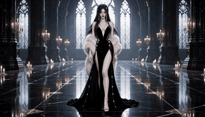
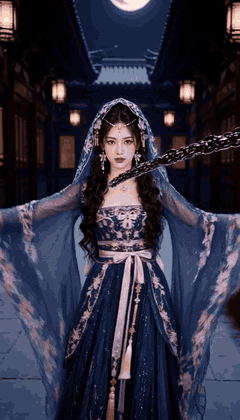
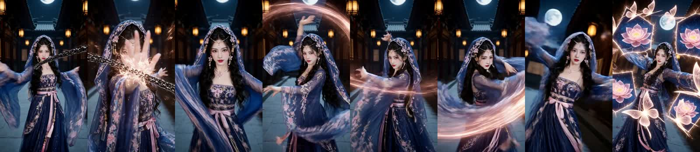

<p align="center">
  
</p>

<h1 align="center">h3-combat-impact</h1>

<p align="center">
  <b>讓 MiniMax H3 / 海螺的打鬥「真的有打到」的 Agent Skill：六拍打擊、具名招式、力場、衝擊幀、震屏。</b>
</p>

<p align="center">
  <a href="README.md">English</a> · <b>繁體中文</b>
</p>

<p align="center">
  <a href="LICENSE"></a>
  
  
  
  
</p>

---

## 為什麼需要這個 skill

AI 打鬥片常見的毛病都一樣：動作軟、特效像貼圖、兩個人像木頭人擺姿勢、鏡頭亂晃、最後兩秒人站著不動。光寫「史詩爆炸」解決不了任何一個。

這個 skill 把「打得更有力」拆成能寫、能複製、**能量測**的結構：

- **六拍打擊**：每一擊都是 蓄 → 觸 → 停 → 洩 → 退 → 收，每拍有時間佔比。
- **力場而非光效**：四通道（光／空氣／物質／粒子）。最便宜的力量證明，是衣襬或髮絲被推開。
- **招式必須具名**：16 招，每招四層（位移、身體機制、物理結果、戰術目的），不再被模型平均成「揮、擋、退」。
- **交換・壓縮・後果**：三條設計原則，重要性高於任何提示詞字句。
- **產出可直接貼上**：最終交付是一個官方 H3 三欄位格式的 code block，並附驗證腳本。
- **用數據驗收**：`measure_motion.py` 對生成的 mp4 量測開場過靜、尾端停滯、動作低潮。

## 六拍結構

<p align="center">
  <br>
  <sub>一擊六拍與各自的時間佔比。沒有蓄力，就沒有重量。</sub>
</p>

| 拍 | 佔比 | 畫面要有 | 提示詞關鍵句 |
|---|---:|---|---|
| 1 蓄 | 35% | 反向預備、重心下沉、布料繃緊 | `weight sinks into the rear leg` |
| 2 觸 | 5% | **衝擊幀**：1–2 幀爆白／爆黑 | `for two frames the entire frame blows out to pure white` |
| 3 停 | 15% | 時間近乎凍結，塵與火花懸浮 | `decelerates to a near-freeze for two frames` |
| 4 洩 | 25% | 衝擊波、碎片、塵環、光影聯動 | `a ring of shockwave dust bursts outward` |
| 5 退 | 15% | 受擊者被打飛、衣髮延遲甩動、**震屏衰減** | `the shake decays within a third of a second` |
| 6 收 | 5% | 回到防禦姿勢、餘燼飄落、鏡頭回穩 | `settles into a low guard` |

三條鐵律：蓄 ≥ 觸的 5 倍；停（Hit Stop）是「重量」唯一來源；一擊只給一個視覺高潮。「壓著打」的連續纏鬥另有四拍模式、沒有凍結幀（[`continuous-brawl.md`](references/continuous-brawl.md)）。

## 力場：光效只是顏色，力場才是空氣

<p align="center">
  <br>
  <sub>每擊最多同時開三個通道。優先順序：空氣 &gt; 物質 &gt; 光 &gt; 粒子。</sub>
</p>

```text
✗  epic explosion, glowing shockwave
✓  wind pressure flattens the silk against her body, the air ripples in a heat-haze ring,
   roof tiles rattle loose
```

## 實際生成對照

下面兩支都是我自己的 H3 測試片，並用內附腳本量測。

<table>
  <tr>
    <td align="center" width="55%"><br><sub><b>V01 · 初版</b> · 開場 3.24 · 旗標：<code>開場過靜</code></sub></td>
    <td align="center" width="45%"><br><sub><b>V06 · 套用規則後</b> · 開場 20.44 · 零旗標</sub></td>
  </tr>
</table>

<p align="center"><br><sub>V06 以 2 fps 抽格。與 V01 主題、比例不同，重點是運動曲線，不是同題前後對照。</sub></p>

七版實測，同一支腳本：

| 版 | 字數 | 鏡數 | 開場 0.8s | 末2s÷中段 | 最長低潮 | 旗標 |
|---|---:|---:|---:|---:|---:|---|
| V01 | 525 | 4 | 3.24 | 80% | 0.17s | 開場過靜 |
| V02 | 667 | 4 | 23.59 | 32% | 1.17s | 尾端停滯、低潮 |
| V04 | 885 | 5 | 18.12 | 27% | 0.17s | 尾端停滯（提示詞寫 8 秒、實際生成 10.1 秒） |
| **V06** | **1022** | **5** | **20.44** | **108%** | **0.04s** | **無** |

數據改變了什麼：尾端停滯的主因是時長設定錯配，不是文字；一句 `First contact occurs within the opening half-second.` 就把開場從 3.24 拉到 20.44。分數量的是「畫面變化」，特效會灌水，所以仍要目視確認主體有動。

## 安裝

```bash
git clone https://github.com/ayase0307/h3-combat-impact ~/.claude/skills/h3-combat-impact
```

任何讀 `SKILL.md` 的 agent 都能用（Claude Code、Codex 等）。Windows 請 clone 到 `%USERPROFILE%\.claude\skills\`。

然後直接用白話說：

> 「幫我寫一段 8 秒屋頂對決的 H3 提示詞，現在很飄，要有打擊感。」
> 「拆解這支打鬥參考片，用 H3 格式重現。」

## 工具

```bash
# 貼進模型前先檢查格式（FAIL 必須修掉）
python scripts/validate_prompt.py prompt.txt --duration 8

# 量測生成影片的運動曲線（需要 ffmpeg 在 PATH）
python scripts/measure_motion.py --dir ./outputs
python scripts/measure_motion.py --dir ./outputs --symmetry   # 標記「靜止對稱」的技能展示構圖
```

| 指標 | 合格 |
|---|---|
| 開場 0.8s | ≥ 中段 50% |
| 末 2s ÷ 中段 | ≥ 60% |
| 最長低潮 | ≤ 0.8s |
| 峰值格 | ≥ 4 |

## 檔案一覽

| 檔案 | 內容 |
|---|---|
| [`SKILL.md`](SKILL.md) | 規格、六拍方法、力場、設計原則、可量測規則、工作流程 |
| [`references/output-format.md`](references/output-format.md) | 官方三／六欄位格式、對齊句、對白標籤、常見錯誤 |
| [`references/impact-design.md`](references/impact-design.md) | 六拍細節、力度分級、材質反應、節奏預算 |
| [`references/move-library.md`](references/move-library.md) | 16 招具名動作、4 組三招串接、中英翻譯規則 |
| [`references/continuous-brawl.md`](references/continuous-brawl.md) | 連續對轟四拍模式 |
| [`references/force-field.md`](references/force-field.md) | 力場四通道、三種場型、句庫 |
| [`references/impact-frame-and-shake.md`](references/impact-frame-and-shake.md) | 衝擊幀形態與幀數、震屏衰減、hitstop 參數 |
| [`references/camera-grammar.md`](references/camera-grammar.md) | 官方運鏡詞彙、打鬥運鏡套路 |
| [`references/vfx-vocabulary.md`](references/vfx-vocabulary.md) | 中英特效詞彙庫、色彩腳本 |
| [`references/prompt-templates.md`](references/prompt-templates.md) | T2VA / FL2VA / Ref2VA 填空模板 |
| [`references/qa-checklist.md`](references/qa-checklist.md) | 生成前後檢查、失敗對應修法 |
| [`references/case-wuxia-duel.md`](references/case-wuxia-duel.md) | 27.5 秒對決的拆解與四段式重現 |
| [`scripts/validate_prompt.py`](scripts/validate_prompt.py) | 格式驗證 |
| [`scripts/measure_motion.py`](scripts/measure_motion.py) | 運動曲線量測 |

## 誠實的限制

- 數據來自我自己在單一環境的七版實測，是佐證，不是基準測試。
- 運動分數量的是畫面變化，不是主體運動。
- 案例分析的對象是第三方參考片，影片本身不包含在此 repo。
- H3 沒有負面提示欄；所有「不要」都改寫成正面約束句。

## 授權

MIT
