<p align="center">
  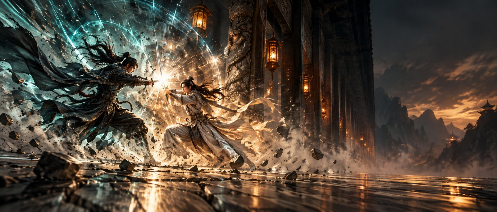
</p>

<h1 align="center">h3-combat-impact</h1>

<p align="center">
  <b>讓 MiniMax H3 / 海螺的打鬥「真的有打到」的 Agent Skill：六拍打擊、具名招式、力場、衝擊幀、無人機式運鏡。</b>
</p>

<p align="center">
  <a href="README.md">English</a> · <b>繁體中文</b>
</p>

<p align="center">
  <a href="LICENSE"></a>
  
  
  
  
</p>

---

## 成品展示

下面每一支都是 MiniMax H3 在本機 RTX 4060 Ti（8 GB）上，用 [`examples/`](examples/) 裡的提示詞生成：固定種子、24 fps、`high` 畫質、1280×704（21:9 那支是 1280×544）。點標題可看完整 MP4。

<table>
  <tr>
    <td align="center" width="50%">
      <a href="assets/showcase/blade-light.mp4">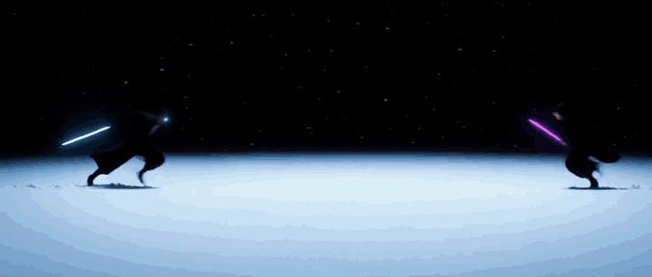</a><br>
      <b><a href="assets/showcase/blade-light.mp4">21:9 刃光電影</a></b><br>
      <sub>藍雪上的逆光剪影，唯一的紫色異物色 · <a href="examples/blade-light-21x9.txt">提示詞</a></sub>
    </td>
    <td align="center" width="50%">
      <a href="assets/showcase/ultra-speed.mp4"></a><br>
      <b><a href="assets/showcase/ultra-speed.mp4">超高速・無人機式運鏡</a></b><br>
      <sub>8 秒 12 鏡，每次切鏡都換機位 · <a href="examples/ultra-speed-drone.txt">提示詞</a></sub>
    </td>
  </tr>
  <tr>
    <td align="center">
      <a href="assets/showcase/ink-wash.mp4">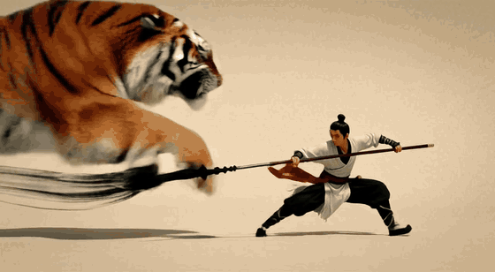</a><br>
      <b><a href="assets/showcase/ink-wash.mp4">水墨墨爆</a></b><br>
      <sub>用墨刺加 1 幀亮暗翻轉取代凍結 · <a href="examples/ink-wash.txt">提示詞</a></sub>
    </td>
    <td align="center">
      <a href="assets/showcase/six-beat.mp4">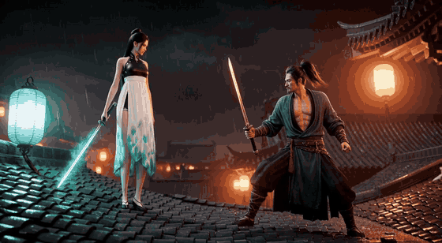</a><br>
      <b><a href="assets/showcase/six-beat.mp4">六拍單次重擊</a></b><br>
      <sub>蓄力、爆白、衝擊波、被打飛 · <a href="examples/six-beat-single-hit.txt">提示詞</a></sub>
    </td>
  </tr>
  <tr>
    <td align="center">
      <a href="assets/showcase/anime-30s.mp4">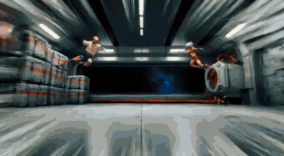</a><br>
      <b><a href="assets/showcase/anime-30s.mp4">兩張參考圖生成的 30 秒 2D 動漫格鬥</a></b><br>
      <sub>2 × 15 秒 Ref2VA，角色保真 · <a href="examples/anime-ref2va-part1.txt">上半</a> · <a href="examples/anime-ref2va-part2.txt">下半</a></sub>
    </td>
    <td align="center">
      <a href="assets/showcase/face.mp4">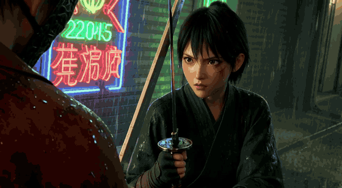</a><br>
      <b><a href="assets/showcase/face.mp4">臉部表演</a></b><br>
      <sub>寫肌肉動作，不寫形容詞 · <a href="examples/facial-performance.txt">提示詞</a></sub>
    </td>
  </tr>
  <tr>
    <td align="center">
      <a href="assets/showcase/character-bloodmoon.mp4">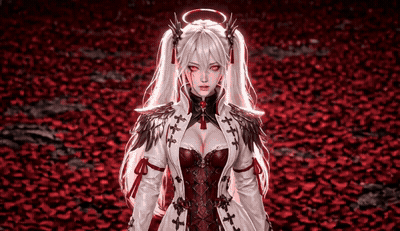</a><br>
      <b><a href="assets/showcase/character-bloodmoon.mp4">角色重現 A · 血月少女</a></b><br>
      <sub>10 秒 Ref2VA，3 張自製參考圖（四視圖／雙頭戟／碎鏡板） · <a href="examples/bloodmoon-ultimate-ref2va.txt">提示詞</a></sub>
    </td>
    <td align="center">
      <a href="assets/showcase/character-jade.mp4">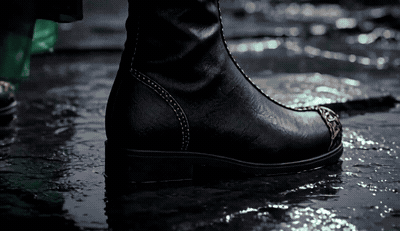</a><br>
      <b><a href="assets/showcase/character-jade.mp4">角色重現 B · 執傘女修</a></b><br>
      <sub>10 秒 Ref2VA，3 張自製參考圖（四視圖／玉骨傘／裂空巨爪板） · <a href="examples/jade-rift-summon-ref2va.txt">提示詞</a></sub>
    </td>
  </tr>
  <tr>
    <td align="center" colspan="2">
      <a href="assets/showcase/impact-composite.mp4">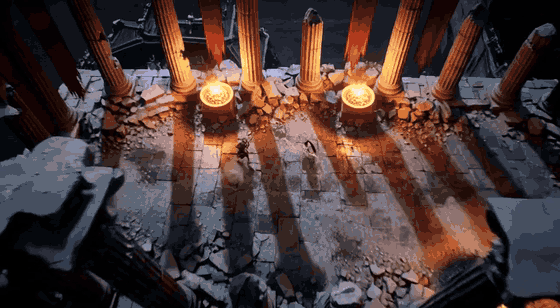</a><br>
      <b><a href="assets/showcase/impact-composite.mp4">後製加上衝擊幀</a></b><br>
      <sub>主片完全沒有衝擊幀；另外生成一支 H3 漫畫放射片，取 3 × 2 幀逐幀精準合成 · <a href="references/impact-frame-post.md">做法</a></sub>
    </td>
  </tr>
</table>

30 秒格鬥是「重現」不是複製：它參考一支公開的 Seedance 2.5 展示片的結構（分鏡表、每次爆炸換色調、貨艙佈局），改寫成 H3 的格式與限制。參考角色圖不在此 repo。

## 為什麼需要這個 skill

AI 打鬥片的毛病都差不多：動作軟、特效像貼圖、兩個人像木頭人擺姿勢、臉像死人、鏡頭一直繞圈、最後兩秒站著不動。光寫「史詩爆炸」解決不了。

這個 skill 把「打得更有力」拆成能寫、能複製、**能量測**的結構：

- **六拍打擊**：蓄 → 觸 → 停 → 洩 → 退 → 收，每拍有時間佔比。
- **每鏡五小節**：Camera／Motion／Performance／Light／Sound，而且 **Motion 一定要寫支撐重心**——打擊感最便宜的來源。
- **速度＝動作密度**：不是形容詞。分鏡 1–2 秒 × 每鏡 3 個具名動作（8 秒 18–24 個動作）。
- **力場而非光效**：光／空氣／物質／粒子四通道；最便宜的力量證明，是衣襬或髮絲被推開。
- **具名招式**：16 招，每招四層，不再被平均成「揮、擋、退」。
- **特效有形狀與空間範圍**：未知招式的三步翻譯法（物理名詞 → 路徑 → 命中結果）。
- **三種節奏模式**：六拍、連續對轟、ULTRA_SPEED（8 秒 10–14 鏡，每次切鏡換機位）。
- **參考圖保真**：Ref2VA 的 9 類身份清單，讓角色保持「就是那一個」。
- **衝擊幀三條路線**：多卡閃切（1.2 秒 8 張卡 → 剪輯留 2 幀）／變身六層 0.3 秒序列／後製逐幀合成。
- **角色技能可移植**：角色卡十欄 ＋ 技能四節點 ＋ 八個母題原型，任何角色都能套。
- **產出可直接貼上**：官方 H3 格式的單一 code block，附驗證器。
- **用數據驗收**：腳本對成品 MP4 量測運動、光事件、分鏡、接縫。

## 六拍結構

<p align="center">
  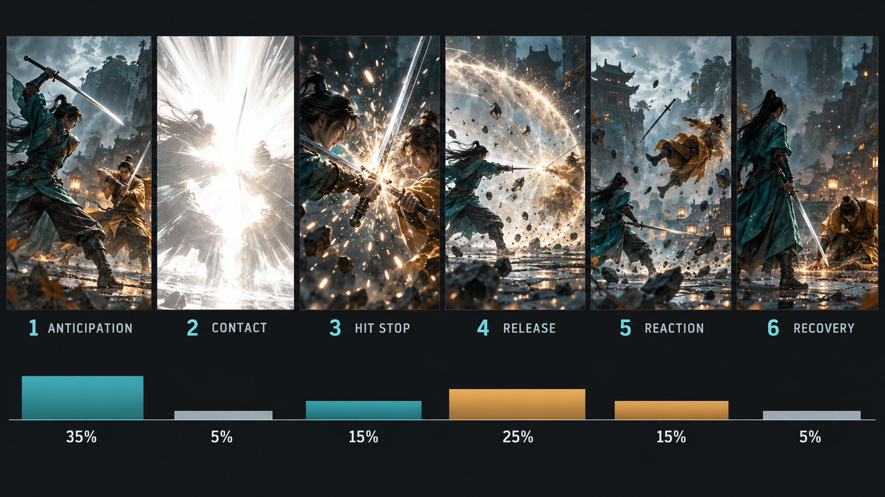<br>
  <sub>一擊六拍與各自的時間佔比。沒有蓄力，就沒有重量。</sub>
</p>

| 拍 | 佔比 | 畫面要有 | 提示詞關鍵句 |
|---|---:|---|---|
| 1 蓄 | 35% | 反向預備、重心下沉、布料繃緊 | `weight sinks into the rear leg` |
| 2 觸 | 5% | **衝擊幀**：1–2 幀爆白／爆黑 | `for two frames the entire frame blows out to pure white` |
| 3 停 | 15% | 時間近乎凍結，塵與火花懸浮 | `decelerates to a near-freeze for two frames` |
| 4 洩 | 25% | 衝擊波、碎片、塵環、光影聯動 | `a ring of shockwave dust bursts outward` |
| 5 退 | 15% | 受擊者被打飛、衣髮延遲甩動、**震屏衰減** | `the shake decays within a third of a second` |
| 6 收 | 5% | 回到防禦姿勢、餘燼飄落、鏡頭回穩 | `settles into a low guard` |

蓄 ≥ 觸的 5 倍；一擊只給一個視覺高潮。「壓著打」用沒有凍結的四拍模式（[`continuous-brawl.md`](references/continuous-brawl.md)）；要「喘不過氣」的快切用 [`ultra-speed.md`](references/ultra-speed.md)。

## 力場：光效只是顏色，力場才是空氣

<p align="center">
  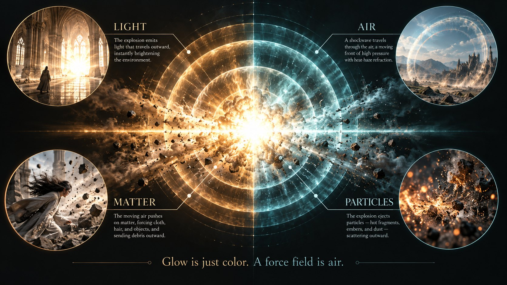<br>
  <sub>每擊最多同時開三個通道。優先順序：空氣 &gt; 物質 &gt; 光 &gt; 粒子。</sub>
</p>

```text
✗  epic explosion, glowing shockwave
✓  wind pressure flattens the silk against her body, the air ripples in a heat-haze ring,
   roof tiles rattle loose
```

## 每鏡五小節（打鬥版）

打鬥的一鏡同時要做四件事：換機位、跑動作、演表情、炸特效。只寫一句動作時，模型會把這四件事都補成平均值——
運鏡沒有落點、動作沒有重心、臉是死的、光是平的。所以每一鏡都寫滿五小節：

| 小節 | 打鬥時必須寫進去 |
|---|---|
| **① Camera** | 焦距＋物距＋機位高度；運鏡幅度／速度／時長；**起幅與落幅** |
| **② Motion** | 起始 → 施力點 → **支撐與重心** → 慣性 → 結束（每鏡仍只 1 個主動作） |
| **③ Performance** | 眉／下眼瞼／咀嚼肌／唇／喉／呼吸，寫「部位＋動作」，不寫形容詞 |
| **④ Light** | 光源方向＋色溫；**特效本身是光源**；跨鏡一致 |
| **⑤ Sound** | 鏡內音效的**秒數**、環境音、台詞起口時間 |

**Motion 的支撐重心是成本最低的打擊感來源。** 同一招寫不寫重心，模型給的是兩個東西：

```text
✗  She swings the halberd.
✓  Her weight sinks into the rear leg, she drives off that heel, the front foot takes
   the whole body, her hips rotate ahead of her shoulders, and her mass arrives behind
   the blade head at the moment of contact.
```

四個可寫的重心參數（每鏡挑 1–2 個）：**承重腳**、**重心位移**、**支點**、**失衡／慣性**。

五小節寫滿後每鏡約 120–190 英文字；8 秒 4–5 鏡 ≈ 750 字。Ref2VA 六欄位＋五小節的 10 秒 6 鏡
≈ 1300 字／7.4k 字元，**已經貼著 7500 字元上限**，再長就要拆段。

```bash
python scripts/validate_prompt.py prompt.txt --duration 8 --five-part
```

## 角色 × 獨特技能：可移植的設計系統

好看的不是「招式多」，是**一個固定的技能母題 + 一套從不更換的視覺語法**。
所以「重現」的目標不是複製鏡頭，是複製「這個角色的技能怎麼被看見」。

| 層 | 內容 | 換角色時 |
|---|---|---|
| ① 角色卡 | 身份錨點十欄（剪影／臉／記憶點／髮／配件數量／服裝三層／顏色歸屬／武器／動作特徵／一句台詞） | 整層換 |
| ② 技能母題 | 起手 → 成形 → 命中 → 殘留，四個節點**必須分鏡** | 可以整組搬 |
| ③ 視覺語法 | 一色、一形、一音、一殘留物 | 通常不換 |

<table>
  <tr>
    <td align="center" width="50%">
      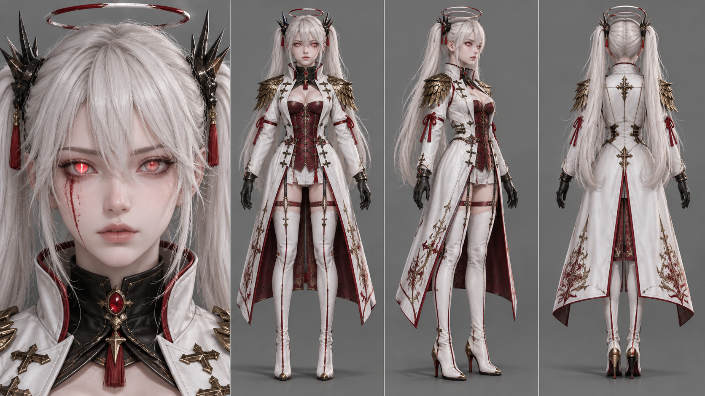
      <br><b>A · 血月少女「白薔薇 · 一響」</b>
      <br><sub>碎鏡領域 → 天降光柱。起手只有一個：打響指。</sub>
    </td>
    <td align="center" width="50%">
      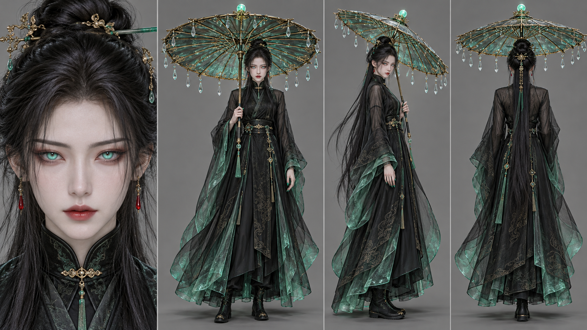
      <br><b>B · 執傘女修「青鸞 · 裂空」</b>
      <br><sub>裂空召請 → 三隻符文巨爪扒開裂縫。</sub>
    </td>
  </tr>
</table>

八個母題原型（碎鏡領域／裂空召請／天降光柱／連閃殘影／巨物壓制／凝結凍結／吞噬漩渦／回聲多重像）
配五個可換變數（起手動作／成形載體／命中方式／殘留物／主色），任何角色都能套。
素材生成順序：**角色四視圖 → 武器道具 → 技能 VFX 板 → 關鍵幀**；四視圖定位是 Ref2VA 的身份參考，
**不是 I2VA 首幀**（圖片模型的畫風跟 H3 差一截，拿來當首幀整段會跳）。

見 [`character-signature-skill.md`](references/character-signature-skill.md)、
[`bloodmoon-ultimate-ref2va.txt`](examples/bloodmoon-ultimate-ref2va.txt)、
[`jade-rift-summon-ref2va.txt`](examples/jade-rift-summon-ref2va.txt)。

## 每一種提示詞類型，都實測過

全部固定同一個種子。「末段÷中段」是片尾 2 秒運動量除以中段（[`measure_motion.py`](scripts/measure_motion.py)，合格 ≥ 60%）。數字預設為草稿（`light`）畫質，HQ 欄另標。

| 提示詞類型 | 範例 | 初版 | 修正後／高畫質 | 結論 |
|---|---|---|---|---|
| 六拍單次重擊 | [`six-beat-single-hit.txt`](examples/six-beat-single-hit.txt) | 110%；爆白幀有出現，開場偏慢 | HQ 73% | 過門檻；蓄力要短 |
| 連續對轟 | [`continuous-brawl.txt`](examples/continuous-brawl.txt) | 末段÷中段 118%，動作偏平靜 | – | 可用但平穩，不放展示 |
| ULTRA_SPEED＋無人機運鏡 | [`ultra-speed-drone.txt`](examples/ultra-speed-drone.txt) | 95% | HQ 80% | **強** |
| 21:9 刃光 | [`blade-light-21x9.txt`](examples/blade-light-21x9.txt) | 84% | HQ 67% | 過門檻（HQ 勉強）；暗畫面會壓低分數，要目視 |
| 力場爆炸 | [`force-field-explosion.txt`](examples/force-field-explosion.txt) | **28%**，主體凍住 | 改寫後 66%；HQ 43% | 弱，仍待改進 |
| 水墨墨爆 | [`ink-wash.txt`](examples/ink-wash.txt) | 71% | HQ 52%（尾端偏靜） | HQ 未過 60%；畫面對，結尾偏安靜 |
| 臉部表演 | [`facial-performance.txt`](examples/facial-performance.txt) | **40%** | 改寫後 133%；HQ 182% | 修正後強 |
| Ref2VA 角色保真 | [`anime-ref2va-part1.txt`](examples/anime-ref2va-part1.txt) | 94% | HQ 89% | **強** |
| Ref2VA 第二段 15 秒 | [`anime-ref2va-part2.txt`](examples/anime-ref2va-part2.txt) | **34%** | 改寫後 88%；HQ 93% | 修正後強 |
| I2VA 特效插入鏡 | [`SKILL.md`](SKILL.md) | 保住配色（鋼藍＋金）；首幀 PSNR ≈ 20 dB | – | 適合 1–4 秒插入鏡，運動偏低 |
| 後製衝擊幀 | [`impact-frame-source.txt`](examples/impact-frame-source.txt) | 6 幀連續，已驗證 | – | 24fps 主片可行，逐幀精準 |
| 角色重現 A（血月少女 10 s） | [`bloodmoon-ultimate-ref2va.txt`](examples/bloodmoon-ultimate-ref2va.txt) | 末段÷中段 32%（終結鏡刻意鎖死） | – | 身份／服裝／技能形狀全保住；9 鏡、55.6% 有光事件 |
| 角色重現 B（執傘女修 10 s） | [`jade-rift-summon-ref2va.txt`](examples/jade-rift-summon-ref2va.txt) | 末段÷中段 **161%**；峰值 23；低潮 1.42 s | – | 裂空與巨爪成形正確；暗色單色場景的光事件量測偏低 |

這幾支同時做了兩個修改，無法分開歸因：

- **最後一鏡寫成「動作進行中」**：`both fighters are still mid-motion as the frame ends` 讓力場片從 28% 到 66%、臉部片從 40% 到 133%、15 秒動漫下半從 34% 到 88%。末鏡寫「hold」「settle」，H3 就會把它凍住。
- **單鏡靜態場景改寫成 3–4 鏡**，每鏡有機位變化與環境反應。

提示詞格式 A/B（15 秒 Ref2VA、同參考圖同種子）：作者風格的中文提示詞、`[Shot 1]` 帶時間區間前綴，末段÷中段 108%；官方格式 113%，兩者都沒有停滯。驗證器仍以官方格式為準（[`fl2va-chain.md`](references/fl2va-chain.md) §5.6）。

## 安裝

```bash
git clone https://github.com/ayase0307/h3-combat-impact ~/.claude/skills/h3-combat-impact
```

任何讀 `SKILL.md` 的 agent 都能用（Claude Code、Codex 等）。Windows 請 clone 到 `%USERPROFILE%\.claude\skills\`。

然後直接用白話說：

> 「幫我寫一段 8 秒屋頂對決的 H3 提示詞，現在很飄，要有打擊感。」
> 「拆解這支打鬥參考片，用 H3 格式重現。」
> 「讓這個參考角色在太空站貨艙打 30 秒。」

## 工具

```bash
# 貼進模型前先檢查格式（FAIL 必須修掉）
python scripts/validate_prompt.py prompt.txt --duration 8

# 量測生成影片的運動曲線（需要 ffmpeg 在 PATH）
python scripts/measure_motion.py --dir ./outputs
python scripts/measure_motion.py ref.mp4 --fps24            # 比較前先換算成 24fps

# 後製合成衝擊幀（逐幀精準：--at 請給 幀號/24）
python scripts/impact_frame.py composite --main main.mp4 --impact burst.mp4 \
    --at 3.875 --frame 3 --hold 0.083 --out out.mp4
```

| 指標 | 合格 |
|---|---|
| 開場 0.8s | ≥ 中段 50% |
| 末 2s ÷ 中段 | ≥ 60% |
| 最長低潮 | ≤ 0.8s |
| 峰值格 | ≥ 4 |

> 門檻以 24fps 素材校準。宣稱 60fps 的片可能其實是 24fps 加 pulldown，30fps 素材分數約低 20%；比較前請加 `--fps24`。

## 檔案一覽

| 檔案 | 內容 |
|---|---|
| [`SKILL.md`](SKILL.md) | 規格、六拍方法、力場、設計原則、工作流程 |
| [`references/output-format.md`](references/output-format.md) | 官方三／六欄位格式、對齊句、對白標籤 |
| [`references/impact-design.md`](references/impact-design.md) | 六拍細節、力度分級、材質反應 |
| [`references/move-library.md`](references/move-library.md) | 16 招具名動作、4 組串接、中英翻譯規則 |
| [`references/choreography.md`](references/choreography.md) | 招式編排：配額制（刀路上限）、真摔與僵持的分辨、三招三高度 |
| [`references/cinematic-camera.md`](references/cinematic-camera.md) | 電影級運鏡：三檔速度、幅度跳級、因果運鏡、十個電影級機位 |
| [`references/continuous-brawl.md`](references/continuous-brawl.md) | 連續對轟四拍模式 |
| [`references/ultra-speed.md`](references/ultra-speed.md) | ULTRA_SPEED：8 秒 10–14 鏡、每鏡一個光事件 |
| [`references/drone-camera.md`](references/drone-camera.md) | 無人機運鏡：8 種機位、五種尺度、禁止只繞圈 |
| [`references/blade-light-cinema.md`](references/blade-light-cinema.md) | 21:9 刃光電影語言、漫畫衝擊格、單色夜戰 |
| [`references/ref-identity-lock.md`](references/ref-identity-lock.md) | 參考圖保真：9 類身份特徵、畫風材質錨 |
| [`references/facial-performance.md`](references/facial-performance.md) | 用肌肉動作寫表情 |
| [`references/impact-frame-and-shake.md`](references/impact-frame-and-shake.md) | 衝擊幀形態與幀數、震屏衰減、墨爆 |
| [`references/impact-frame-post.md`](references/impact-frame-post.md) | 衝擊幀分開生成再後製合成 |
| [`references/impact-frame-inline.md`](references/impact-frame-inline.md) | 衝擊幀寫進提示詞：多卡閃切、變身六層 0.3 秒、時間膨脹法 |
| [`references/shot-five-part-combat.md`](references/shot-five-part-combat.md) | 每鏡五小節打鬥版：四種重心參數、字數預算、完整範例 |
| [`references/speed-acceleration.md`](references/speed-acceleration.md) | 提速八級排行、動作密度公式、速度詞庫 |
| [`references/vfx-choreography.md`](references/vfx-choreography.md) | 特效五點骨架、空間範圍、未知招式三步翻譯 |
| [`references/character-signature-skill.md`](references/character-signature-skill.md) | 角色卡十欄、技能四節點、八個母題原型、實跑驗證 |
| [`references/fl2va-chain.md`](references/fl2va-chain.md) | 兩段接續、接縫、結尾規則 |
| [`references/force-field.md`](references/force-field.md) | 力場四通道、三種場型、句庫 |
| [`references/camera-grammar.md`](references/camera-grammar.md) | 官方運鏡詞彙、打鬥運鏡套路 |
| [`references/vfx-vocabulary.md`](references/vfx-vocabulary.md) | 中英特效詞彙庫、色彩腳本 |
| [`references/prompt-templates.md`](references/prompt-templates.md) | T2VA / FL2VA / Ref2VA 填空模板 |
| [`references/qa-checklist.md`](references/qa-checklist.md) | 生成前後檢查、失敗對應修法 |
| [`references/guided-mode.md`](references/guided-mode.md) | 引導模式：入口與情境選項 |
| [`references/case-wuxia-duel.md`](references/case-wuxia-duel.md) | 27.5 秒對決的拆解與重現 |
| [`examples/`](examples/) | 展示與上方實測表用到的十二份提示詞（含兩份角色重現） |
| [`assets/characters/`](assets/characters/) | 兩名角色的四視圖、武器三視圖、技能 VFX 板（Ref2VA 參考素材） |
| [`scripts/`](scripts/) | `validate_prompt`（支援 `--five-part`）、`measure_motion`、`measure_staging`、`measure_light_event`、`impact_frame`、`submit_ref2va`、`submit_chain`、`seam_check`、`submit_ab`、`poll_ab`、`compare_clips` |

## 誠實的限制

- 數據來自我自己在單一環境的實測，每種提示詞一個種子，是佐證，不是基準測試。
- 運動分數量的是畫面變化，不是主體運動；暗畫面或剪影片即使看起來對，分數也會偏低，仍要目視。
- 高畫質重跑與草稿是不同樣本，分數會變動，表格兩者都列。
- 力場類在高畫質下仍偏弱。
- 案例分析與 30 秒格鬥分析的是第三方參考片，影片與角色圖不包含在此 repo。
- H3 沒有負面提示欄；所有「不要」都改寫成正面約束句。
- 五小節的**打鬥版**（重心規則、鏡數密度、字數預算）是本 skill 的推論，尚未做同種子 A/B；上游只驗過 T2VA 15 秒與 Ref2VA 8–9 秒的主觀實戰。
- 提速八級排行、特效五點骨架、衝擊幀多卡法來自三支教學片的**口述與畫面文字**，本 skill 沒有逐項重跑；只轉錄數字與句子，並標明出處。
- 兩支角色重現是 832×480、`light` 畫質的**單次**執行，不是最佳化後的成品。

## 授權

MIT


