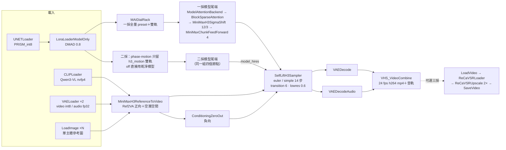

# 系統規格、模型權重、工作流與插件安裝手冊（v4.0）

> 本手冊是 `scripts/render_comfy.py` 本機出片管線的環境說明：開發基準硬體、顯存分級調參、每一個權重檔的存放位置與下載來源、四段式工作流架構、可直接提交的 API 工作流 JSON，以及必裝／選配 ComfyUI 插件清單。
> 連結與授權快照依據 [`verified-ecosystem-links.json`](verified-ecosystem-links.json)（2026-11-26 以 GitHub／HF API 逐一核驗）。標註「本次補核驗」者為撰寫本手冊時另以 `gh api` 或 HF API 確認存在的倉庫。

---

## 1. 開發與實測基準硬體

本倉庫所有 v3.0／v4.0 實測數據（清晰度、耗時、Sulphur-3 A/B）都在這台機器上產出：

| 項目 | 規格 |
|---|---|
| GPU | NVIDIA GeForce RTX 5070 Ti（16 GB GDDR7 VRAM，Driver 610.88） |
| CPU | Intel Core i5-14600KF |
| RAM | 96 GB DDR5 |
| 作業系統 | Windows 11 專業版 |
| ComfyUI | 0.45.3（Comfy Desktop；實測執行個體回報 Python 3.13.12、PyTorch 2.12.1+cu130、comfy-kitchen 0.2.41） |
| 最低軟體需求 | Python 3.12 以上、CUDA 版 PyTorch；`H3-Optimizations` 需 ComfyUI 0.40.0 以上 |

> v1 基準片段（README 的 v1 展示牆，1280×704）是在 RTX 4060 Ti 8 GB 上產出，早於 SelfLift 管線。

### 1.1 顯存分級調參對照表

**只有 16 GB 這一級是實測值**；其餘三級是依權重大小與 16 GB 實測峰值推估的起點，請先用 `--seconds 3` 冒煙測試再拉長。

| 顯存 | 建議底模／路線 | 關鍵參數 | 備註 |
|---|---|---|---|
| **8 GB** | Pika 6 步 LCM 草稿：`--engine pika --stage draft`（1088×640）或 `draft480`；或改用 w6a8 量化底模 | `--seconds` 先從 5–8 秒起跳 | Pika 路線清晰度遠低於 SelfLift（中位數 10.9 vs 179.8），只適合構圖與節奏預覽。GGUF 底模需 `ComfyUI-GGUF` 的載入節點，`render_comfy.py` 目前**不會**自動建這類節點，要自行改圖 |
| **12 GB** | SelfLift ＋ w6a8 底模（如 PRISM 倉庫的 w6a8 版，或 Comfy-Org 的 `ref2va` w6a8）：`--unet <w6a8 檔名>` | `--chunks 4`、`--lowres-scale 0.6`、`--stage final`；不夠就退 `draft` | `upscaler_unload=True` 已寫死在圖內，潛空間超分模型用完即卸載 |
| **16 GB（主力，實測）** | `PRISM_int8` ＋ DMAD 0.8 ＋ SelfLift 14 步 | `--chunks 4`、`--lowres-scale 0.6`、`--transition 6`、`--stage final`（1344×768）、`upscaler_unload=True` | 8 秒 768p 實測約 251–310 秒（不同批次）。Sulphur-3 fp32 修正器兩段同掛時，8 秒 768p 卡在二採第 1 步 765 秒（研判為超出顯存、退到共享記憶體，見 §6） |
| **24 GB 以上** | 同 16 GB 配方 | 可把 `--chunks` 降到 `1–2` 換速度，或改 `--stage hd`（1504×832）／`fhd`（1664×928） | 解析度提高後耗時大約隨像素數成長；仍可接三採 ReCaVSR |

各 `--stage` 的輸出尺寸（`STAGE_DIMS`）：`draft480` 854×480、`draft` 1088×640、`final`／`derope` 1344×768、`hd` 1504×832、`fhd` 1664×928、`upscale` 為 ReCaVSR 2× 三採。

---

## 2. 模型與權重配置表

所有路徑都以 `<ComfyUI>/models/` 為根目錄。「CLI 參數」欄是 `render_comfy.py` 可覆寫該檔名的旗標；沒有旗標的檔名寫死在建圖函式內，要換檔請改程式或改名。

### 2.1 底模（`models/diffusion_models/`）

| 檔名 | 用途 | CLI 參數 | 來源 |
|---|---|---|---|
| `Minimax-h3_Singularity_x_10Eros-Max_PRISM_int8.safetensors` | **SelfLift 預設冠軍底模**（Ref2VA） | `--unet` | 社群：[OliviaRossi/Minimax-h3_Singularity-x-10Eros-Max_PRISM](https://huggingface.co/OliviaRossi/Minimax-h3_Singularity-x-10Eros-Max_PRISM)（同倉庫另有 fp16、w6a8 版）。授權取決於上游合併來源，商用前請逐一確認 |
| `PRISM_DMAD_PDMD_int8.safetensors` | 極速預覽（已內含 DMAD，**必須** `--dmad 0`） | `--unet` | 社群：同上 PRISM 倉庫的 `PRISM_DMAD_PDMD_int8`；本機檔名可能與倉庫不同，請依實際檔名填 `--unet` |
| `minimax_h3_ref2va_pruned_int8_convrot.safetensors` | Pika 6 步路線底模 | 程式常數 `DEFAULT_PIKA_UNET` | 官方重新打包：[Comfy-Org/MiniMax-H3](https://huggingface.co/Comfy-Org/MiniMax-H3) 的 `diffusion_models/`（另有 bf16、fp8_scaled、w6a8 版） |
| 原版 H3 權重 | 參考／自行轉檔 | — | 官方：[MiniMaxAI/MiniMax-H3](https://huggingface.co/MiniMaxAI/MiniMax-H3) |

### 2.2 文字編碼器（`models/text_encoders/`）

| 檔名 | 用途 | CLI 參數 | 來源 |
|---|---|---|---|
| `qwen3vl_32b_minimax_h3_nvfp4_awq.safetensors` | Qwen3-VL-32B 文字／視覺編碼器（預設） | `--clip` | 官方重新打包：[Comfy-Org/MiniMax-H3 `text_encoders/`](https://huggingface.co/Comfy-Org/MiniMax-H3/tree/main/text_encoders)（另有 bf16、int8_convrot） |
| 社群量化備選 | 小顯存 | `--clip` | GGUF：[nif0/Qwen3-VL-32B-Instruct-MiniMax-H3-GGUF](https://huggingface.co/nif0/Qwen3-VL-32B-Instruct-MiniMax-H3-GGUF)（需 ComfyUI-GGUF 與自行改圖）；fp8：[rzgar/qwen3-vl-32b-minimax-h3-fp8-comfyui](https://huggingface.co/rzgar/qwen3-vl-32b-minimax-h3-fp8-comfyui)；NVFP4：[6block/MiniMax-H3-Qwen3-VL-NVFP4](https://huggingface.co/6block/MiniMax-H3-Qwen3-VL-NVFP4) |

### 2.3 影片與音訊 VAE（`models/vae/`）

| 檔名 | 用途 | CLI 參數 | 來源 |
|---|---|---|---|
| `minimax_h3_video_vae_int8_convrot.safetensors` | 影片 VAE（編碼參考圖、解碼成片） | 無（寫死在 `build_selflift_graph`） | [Comfy-Org/MiniMax-H3](https://huggingface.co/Comfy-Org/MiniMax-H3) 的 `vae/` |
| `minimax_h3_audio_vae_fp32.safetensors` | 音訊 VAE（同步音軌解碼） | 無（寫死） | 同上 |

### 2.4 蒸餾與控制 LoRA（`models/loras/`）

| 檔名 | 推薦值 | CLI 參數 | 來源 |
|---|---|---|---|
| `minimax_h3_dmad_full_dareties_v4_step600_comfy_fro.safetensors` | `--dmad 0.8`（`cfg=1.0`） | `--dmad`、`--dmad-lora` | **本機合併檔，不在任何公開倉庫**。公開替代：[ZhengmingYu/DMAD](https://huggingface.co/ZhengmingYu/DMAD) 的 `minimax_h3/*_comfyui` 檔（研究者發布，社群授權），以 `--dmad-lora` 指定並自行微調強度；DMAD＋PDMD 合併單檔見 [OliviaRossi/Minimax-H3-Hybrid-DMAD-PDMD](https://huggingface.co/OliviaRossi/Minimax-H3-Hybrid-DMAD-PDMD)（改用此類合併底模時 `--dmad 0`，避免重複疊掛） |
| `pika_h3_flex_ref2va_v1_bf16.safetensors` | Pika 路線固定掛載 | 程式常數 `DEFAULT_PIKA_LORA` | [Comfy-Org/MiniMax-H3](https://huggingface.co/Comfy-Org/MiniMax-H3) 的 `loras/`；底模說明見官方 [Pika-Labs/Pika-H3-Flex](https://huggingface.co/Pika-Labs/Pika-H3-Flex) |
| Pika Turbo 少步 LoRA | 選配 | `--lora 名稱:強度` | 官方：[Pika-Labs/Pika-H3-Flex-Turbo-LoRA](https://huggingface.co/Pika-Labs/Pika-H3-Flex-Turbo-LoRA)（2/4/8 步、fl2va／ref2va） |

### 2.5 Dials 轉盤（`models/loras/dials/`，API 填 `dials/<檔名>`）

- 下載：[MATLOWAI/H3-Dials](https://huggingface.co/MATLOWAI/H3-Dials)（HF，本次補核驗；授權見倉庫內 `LICENSE-MiniMax-H3-Community.txt`）。請保留倉庫的 `dials/` 與 `dials/experimental/` 子目錄結構。
- 本機實測 19 顆主轉盤的分類、`||v||` 推力與共線運動洩漏係數見 [`references/comfyui-dials-guide.md`](../references/comfyui-dials-guide.md) §1、§3。
- **P9 另外用到實驗盤** `dials/experimental/h3_x_silentfilm_cyberpunk.safetensors`，所以 `experimental/` 子目錄也要下載。
- 不要混掛舊相容檔 `h3_motion_lora.safetensors`：它是 pre-refiner 版本，不支援時間曲線與 `hold`。

各 preset 會用到的轉盤：

| Preset | 轉盤 |
|---|---|
| P1–P4 | `h3_motion`、`h3_dramatic_light`、`h3_storm`、`h3_evil_dread` |
| P5 / P6 | `h3_arcane_sigils` / `h3_space_warp`，加 `h3_dramatic_light`、`h3_evil_dread` |
| P7 / P8 | `h3_dramatic_light`、`h3_storm`、`h3_evil_dread`（運動交給 `--anchor/--burst/--hitstop` 的 `h3_motion` 雙軌） |
| P9 | `h3_motion`、`h3_ink_wash`、`h3_storm`、`h3_dramatic_light`、`experimental/h3_x_silentfilm_cyberpunk`、`h3_impact_frame` |
| `--hit` / `--hitstop` | 另加 `h3_impact_frame` 短脈衝 |

### 2.6 潛空間超分（`models/latent_upscale_models/`）

| 檔名 | 用途 | CLI 參數 | 來源 |
|---|---|---|---|
| `h3_upscaler_lms_v0.1.safetensors` | SelfLift 一採→二採之間的潛空間提升 | `--upscaler` | **本機檔，未在公開倉庫找到同名檔**。SelfLift README 指向的公開選項是 [LBH-123-AI/Minimax_h3_latent_Upscaler](https://huggingface.co/LBH-123-AI/Minimax_h3_latent_Upscaler)（本次補核驗；含 `minimax_h3_latent_upscaler_3d_conv_v1_{bf16,fp16}` 與 2d 版），以 `--upscaler` 指定。SelfLift 節點在未指定時會挑第一個檔名含 `h3` 的模型，找不到就退回最近鄰提升 |

### 2.7 像素超分（`models/recavsr/`）

| 檔名 | 用途 | CLI 參數 | 來源 |
|---|---|---|---|
| `transformer_int8_convrot.safetensors` | 三採 ReCaVSR 2×：1344×768 → 2688×1536（2K） | 程式常數 `DEFAULT_RECAVSR_MODEL` | 社群 ComfyUI 版：[PedroMarinhoDev/ReCaVSR-ComfyUI](https://huggingface.co/PedroMarinhoDev/ReCaVSR-ComfyUI) 的 `recavsr/`；原作者權重：[kopper/ReCaVSR](https://huggingface.co/kopper/ReCaVSR)（Apache-2.0） |

### 2.8 進階實驗權重（預設不用）

| 檔名 | 存放 | 用途 | 實測結論 |
|---|---|---|---|
| `s3_corrector.safetensors` | `models/h3_correctors/`（由 Sulphur-3 的 ComfyUI-H3-Corrector 節點註冊） | `--corrector` | 不開：耗時增加、畫面變軟、看不到破圖改善（§6） |
| `Sulphur-3_Ref2VA-hybrid_mid_int8_convrot_keepB0-1-49.safetensors` | `models/diffusion_models/` | `--unet` | 戰鬥鏡不用：動態量 −36～−37% |

以上兩者都來自社群倉庫 [SulphurAI/Sulphur-3](https://huggingface.co/SulphurAI/Sulphur-3)（作者說明為未審查版本，請自行評估授權與內容風險）。

---

## 3. 工作流架構：一採 → 潛空間超分 → 二採解耦 → 三採 2K 超分



SelfLift 內部流程：一採在 0.6 倍解析度的潛空間跑前 `transition` 步（預設 6 步），由潛空間超分模型提升到全解析度，再由 `model_hires` 跑剩下 8 步；`upscaler_unload=True` 讓超分模型在提升完立刻卸載。

### 3.1 關鍵節點參數表

| 節點（API `class_type`） | 關鍵參數 | 推薦值 | CLI 預設 | 對應 CLI |
|---|---|---|---|---|
| `UNETLoader` | `unet_name` | `…PRISM_int8.safetensors` | 同左 | `--unet` |
| `LoraLoaderModelOnly` | `strength_model` | `0.8`（PDMD 合併底模設 `0`） | `0.8` | `--dmad` |
| `MAIDialRack`（一採） | `rack` JSON | 依 preset；`time.steps` 自動改成 `transition` | `none` | `--preset`、`--anchor`、`--burst`、`--hitstop`、`--hit`、`--rack` |
| 二採 Dials | — | P9：`off`；P7/P8：`phase-motion` | `keep` | `--hires-dials` |
| `ModelAttentionBackend` | `attention` | `comfy kitchen attention` | 寫死 | — |
| `BlockSparseAttention` | `selection` / `tau` / `start_percent` | `sol-attn` / `1.3` / `0.2` | 寫死 | — |
| `MiniMaxH3SigmaShift` | `shift_video` / `shift_audio` | `12.0` / `3.0` | 同左 | `--shift-video`、`--shift-audio` |
| `MiniMaxChunkFeedForward` | `chunks` / `seq_threshold` | `4`（24 GB 可 1–2）/ `4096` | `4` | `--chunks` |
| `BasicScheduler` | `scheduler` / `steps` | `simple` / **`14`** | `simple` / `12` | `--scheduler`、`--steps` |
| `SelfLiftH3Sampler` | `transition_step` / `lowres_scale` / `cfg` | `6` / `0.6` / `1.0` | 同左 | `--transition`、`--lowres-scale`、`--cfg` |
| `SelfLiftH3Sampler` | `highres_tiling` / `upscaler_unload` | `False`（武戲禁用分塊）/ `True` | 寫死 | — |
| `VHS_VideoCombine` | `frame_rate` / `format` / `crf` | `24` / `video/h264-mp4` / `18` | 寫死 | — |
| `ReCaVSRUpscale` | `scale` / `color_fix` / `decoder` | `2.0` / `wavelet` / `flashdecoder` | 寫死 | `--stage upscale` |

> **注意 CLI 預設與推薦值不同**：`--engine` 預設是 `pika`、`--steps` 預設 12、`--hires-dials` 預設 `keep`。要走冠軍配方，請照 README 的命令明確帶上 `--engine selflift --steps 14 --hires-dials off`（或 `phase-motion`）。

### 3.2 選配干預掛點

| 旗標 | 掛在哪裡 | 預設 |
|---|---|---|
| `--lowres-lora 名稱:強度` | 只掛一採（二採保持乾淨 PRISM） | 不掛 |
| `--motion-stg --still-prompt <靜止版劇本>` | 一採骨架期的 `H3SelfLiftMotionSTG`（隨倉節點，見 §5.2） | 不開 |
| `--corrector <檔名> --corrector-stage low/hires/both` | 一採及／或二採模型尾端 | 不開 |

---

## 4. 標準 API 工作流 JSON（`workflows/`）

三份檔案都由 `render_comfy.py` 的真實組圖流程產出：前兩份走 `main()`（所以 `--anchor/--burst` 雙軌曲線也會編進 `MAIDialRack`），第三份直接呼叫 `build_recavsr_graph`。匯出時只攔截上傳與佇列兩個函式，沒有送出任何 GPU 工作。產出後已以本機 `/object_info` 核對所有 `class_type` 與輸入鍵；底模、編碼器、VAE、DMAD LoRA 與潛空間超分的檔名都在對應節點的選項清單內，ReCaVSR 權重與 rack 內的轉盤檔名則以 `/models/recavsr`、`/models/loras` 清單確認存在。

| 檔案 | 內容 | 等效命令 |
|---|---|---|
| [`h3_prism_selflift_p9_ref2va.json`](../workflows/h3_prism_selflift_p9_ref2va.json) | 25 節點：PRISM_int8＋DMAD 0.8＋P9 六轉盤，二採 `off` | 見下方 P9 命令 |
| [`h3_prism_selflift_p8_dualrail.json`](../workflows/h3_prism_selflift_p8_dualrail.json) | 26 節點：P8＋`--anchor 0:4:-0.65`＋`--burst 9:15:0.80`，二採 `phase-motion`（`dr_hi` 只保留兩條 `h3_motion` 雙軌） | 見下方 P8 命令 |
| [`h3_recavsr_2k_upscale.json`](../workflows/h3_recavsr_2k_upscale.json) | 4 節點：`LoadVideo → ReCaVSRLoader → ReCaVSRUpscale 2× → SaveVideo` | `--stage upscale --input-video <mp4>` |

```bash
# P9：與 h3_prism_selflift_p9_ref2va.json 等效
python scripts/render_comfy.py --engine selflift \
  --unet Minimax-h3_Singularity_x_10Eros-Max_PRISM_int8.safetensors --dmad 0.8 \
  --scheduler simple --steps 14 --transition 6 --lowres-scale 0.6 --chunks 4 \
  --preset P9 --hires-dials off --seconds 15 --stage final --seed 7101 \
  --prompt examples/v3-manju/orig01_v13_crimson_frost_blade_duel.txt \
  --ref hero.png --ref villain.png --ref scene.png --job duel_p9 --out out/duel_p9.mp4

# P8 雙軌：與 h3_prism_selflift_p8_dualrail.json 等效
python scripts/render_comfy.py --engine selflift \
  --unet Minimax-h3_Singularity_x_10Eros-Max_PRISM_int8.safetensors --dmad 0.8 \
  --scheduler simple --steps 14 --transition 6 --lowres-scale 0.6 --chunks 4 \
  --preset P8 --hires-dials phase-motion --anchor 0:4:-0.65 --burst 9:15:0.80 \
  --seconds 15 --stage final --seed 7201 \
  --prompt examples/v3-manju/rep04_v4_myriad_swords_cannon.txt \
  --ref hero.png --ref villain.png --ref scene.png --job cannon_p8 --out out/cannon_p8.mp4
```

### 4.1 如何提交或對照

這些檔案是 **API 格式**（節點 ID → `class_type`＋`inputs`），不是 ComfyUI 畫布存檔格式。

1. **上傳參考圖**：把三張參考圖放進 ComfyUI 的 `input/` 目錄，或改掉節點 `30`／`31`／`32` 的 `image` 欄位為實際檔名。三採範本則要把節點 `1` 的 `file` 改成 `input/` 內的 768p 影片檔名。
2. **換劇本**：節點 `7`（`MiniMaxH3ReferenceToVideo`）的 `prompt` 已內嵌範例劇本的英文 H3 區塊，直接替換即可。
3. **提交**：

   ```bash
   python -c "import json,urllib.request as u;g=json.load(open('workflows/h3_prism_selflift_p9_ref2va.json',encoding='utf-8'));op=u.build_opener(u.ProxyHandler({}));print(op.open(u.Request('http://127.0.0.1:8188/prompt',data=json.dumps({'prompt':g}).encode(),headers={'Content-Type':'application/json'})).read().decode())"
   ```

   成功時回傳 `prompt_id`，成片會出現在 `output/h3_combat/`。`ProxyHandler({})` 用來略過系統代理，與 `render_comfy.py` 的做法相同。
4. **對照**：用 `render_comfy.py … --dry` 印出設定與 rack，再和 JSON 裡的 `dr`／`dr_hi` 節點比對；或用任何 JSON diff 工具比對你自己匯出的圖。
5. **重新匯出**：修改 `render_comfy.py` 的預設後，在倉庫根目錄執行下面的腳本即可重產（本倉庫的三份檔案就是這樣產生的，不會送出任何 GPU 工作）：

   ```python
   import json, pathlib, sys
   sys.path.insert(0, "scripts")
   import render_comfy as rc

   cap = {}
   rc.upload = lambda path, mime="image/png": pathlib.Path(path).name          # 不上傳，只填檔名
   rc.queue_and_download = lambda graph, out, preferred_node=None: cap.update(g=graph)  # 攔截佇列

   def export(name, argv):
       sys.argv = ["render_comfy.py", *argv]
       rc.main()
       pathlib.Path("workflows", name).write_text(
           json.dumps(cap["g"], ensure_ascii=False, indent=2) + "\n", encoding="utf-8")

   common = ["--engine", "selflift", "--dmad", "0.8", "--scheduler", "simple", "--steps", "14",
             "--transition", "6", "--lowres-scale", "0.6", "--chunks", "4", "--seconds", "15",
             "--stage", "final", "--ref", "hero.png", "--ref", "villain.png", "--ref", "scene.png"]
   export("h3_prism_selflift_p9_ref2va.json", common + [
       "--preset", "P9", "--hires-dials", "off", "--seed", "7101", "--job", "duel_p9", "--out", "out/duel_p9.mp4",
       "--prompt", "examples/v3-manju/orig01_v13_crimson_frost_blade_duel.txt"])
   export("h3_prism_selflift_p8_dualrail.json", common + [
       "--preset", "P8", "--hires-dials", "phase-motion", "--anchor", "0:4:-0.65", "--burst", "9:15:0.80",
       "--seed", "7201", "--job", "cannon_p8", "--out", "out/cannon_p8.mp4",
       "--prompt", "examples/v3-manju/rep04_v4_myriad_swords_cannon.txt"])
   pathlib.Path("workflows/h3_recavsr_2k_upscale.json").write_text(
       json.dumps(rc.build_recavsr_graph("input_768p.mp4", "duel_p9"), ensure_ascii=False, indent=2) + "\n",
       encoding="utf-8")
   ```

> `VHS_VideoCombine` 的 `pix_fmt`、`crf`、`save_metadata`、`trim_to_audio` 是依 `format=video/h264-mp4` 動態出現的欄位，`/object_info` 的靜態清單看不到它們，這是正常現象。
> 本手冊不保證這些 API JSON 能直接拖進 ComfyUI 畫布；保證可用的方式是上面的 `POST /prompt`。

---

## 5. ComfyUI 插件（Custom Nodes）安裝清單

節點歸屬是以本機 ComfyUI `/object_info` 的 `python_module` 欄位逐一查出來的。`ModelAttentionBackend`、`BlockSparseAttention`、`MiniMaxH3SigmaShift`、`MiniMaxH3ReferenceToVideo`、`UNETLoader`、`LoadVideo`、`SaveVideo` 都是 **ComfyUI 內建節點**（0.45.3），不需要另外安裝。

### 5.1 核心必裝（缺一不可）

| 插件 | 提供的節點 | 授權 | 用途 |
|---|---|---|---|
| [facok/comfyui-SelfLift](https://github.com/facok/comfyui-SelfLift) | `SelfLiftH3Sampler` | GitHub 未標註，請自讀倉庫說明 | 一採／二採漸進式解析度採樣 |
| [matlowai/ComfyUI-MAINodes](https://github.com/matlowai/ComfyUI-MAINodes) | `MAIDialRack`、`MAIDialHoldMap`、De-rope 相關節點 | NOASSERTION，請自讀 | 載入 Dials 轉盤與時間曲線 |
| [kijai/ComfyUI-KJNodes](https://github.com/kijai/ComfyUI-KJNodes)（本次補核驗，GPL-3.0） | `MiniMaxChunkFeedForward` | GPL-3.0 | 分塊前饋，16 GB 卡跑 768p 的關鍵 |
| [Kosinkadink/ComfyUI-VideoHelperSuite](https://github.com/Kosinkadink/ComfyUI-VideoHelperSuite) | `VHS_VideoCombine` | GPL-3.0 | 影片＋音軌編碼輸出 |
| [PedroMarinhoDev/ComfyUI-ReCaVSR](https://github.com/PedroMarinhoDev/ComfyUI-ReCaVSR) | `ReCaVSRLoader`、`ReCaVSRUpscale` | GPL-3.0 | 三採 2K 超分（不做 2K 可暫緩） |

> **不需要** [kijai/ComfyUI-SolAttn_triton](https://github.com/kijai/ComfyUI-SolAttn_triton)：作者已標為 DEPRECATED，ComfyUI 與 comfy-kitchen 已內建稀疏注意力；本管線的 `BlockSparseAttention(selection=sol-attn)` 就是內建節點。超分鏈也禁止掛 `SolAttnPatch`。

### 5.2 進階選配

| 插件 | 用途 | 狀態 |
|---|---|---|
| [matlowai/ComfyUI-Dials](https://github.com/matlowai/ComfyUI-Dials) | 轉盤的原始穩定版（簡易 Load/Apply Dial 節點、`DialsMakeDial` 自製轉盤），與 MAINodes 共用同一批轉盤檔 | 選配（AGPL-3.0）；本管線的圖只用 MAINodes 的 `MAIDialRack`，不載入此插件的節點 |
| 隨倉 [`comfy_nodes/ComfyUI-H3-SelfLift-MotionSTG`](../comfy_nodes/ComfyUI-H3-SelfLift-MotionSTG/__init__.py) | `H3SelfLiftMotionSTG`：把 Sulphur-3 的 Motion/STG 引導改成 SelfLift 能用的 MODEL 補丁，對應 `--motion-stg` | 實驗選配；n=1 待複驗，預設不開 |
| [tazmannner/ComfyUI-H3-FastDerope](https://github.com/tazmannner/ComfyUI-H3-FastDerope) | 只重繪需要修的高速拖影片段 | 建議，腳本未引用（MIT） |
| [KadoBOT/ComfyUI-H3-Continuity-Studio](https://github.com/KadoBOT/ComfyUI-H3-Continuity-Studio) | 多鏡頭、跨場景連戲 | 建議，腳本未引用（MIT） |
| [Carasibana/ComfyUI-H3-FaceRefine](https://github.com/Carasibana/ComfyUI-H3-FaceRefine) | 遠景小臉追蹤精修 | 建議，腳本未引用（MIT） |
| [city96/ComfyUI-GGUF](https://github.com/city96/ComfyUI-GGUF) | 載入 GGUF 量化權重 | 建議，需自行改圖（Apache-2.0） |
| [Zironic/H3-Optimizations](https://github.com/Zironic/H3-Optimizations) | 降低峰值 VRAM；可選稀疏注意力換速度 | 建議，腳本未引用；需 ComfyUI ≥ 0.40.0 |
| [tazmannner/ComfyUI-H3-RelayHires](https://github.com/tazmannner/ComfyUI-H3-RelayHires) | 小解析度接力到 1920×1088（偏 2D 動畫） | 高解析度替代路線（MIT） |

### 5.3 一鍵安裝腳本範例

```bash
# 先把兩個路徑改成你自己的（Windows 用 Git Bash）
COMFYUI="$HOME/ComfyUI"                                   # ComfyUI 安裝目錄
SKILL_REPO="$HOME/.claude/skills/h3-combat-impact"        # 本倉庫位置
cd "$COMFYUI/custom_nodes"

# 核心必裝
git clone https://github.com/facok/comfyui-SelfLift
git clone https://github.com/matlowai/ComfyUI-MAINodes
git clone https://github.com/kijai/ComfyUI-KJNodes
git clone https://github.com/Kosinkadink/ComfyUI-VideoHelperSuite
git clone https://github.com/PedroMarinhoDev/ComfyUI-ReCaVSR

# 依各倉庫的 requirements.txt 安裝相依套件（用 ComfyUI 自己的 Python）
for d in comfyui-SelfLift ComfyUI-MAINodes ComfyUI-KJNodes ComfyUI-VideoHelperSuite ComfyUI-ReCaVSR; do
  [ -f "$d/requirements.txt" ] && python -m pip install -r "$d/requirements.txt"
done

# 進階選配：隨倉 Motion/STG 節點（從本倉庫複製）
cp -r "$SKILL_REPO/comfy_nodes/ComfyUI-H3-SelfLift-MotionSTG" .

# 其他選配（需要時再裝）
# git clone https://github.com/matlowai/ComfyUI-Dials
# git clone https://github.com/tazmannner/ComfyUI-H3-FastDerope
# git clone https://github.com/KadoBOT/ComfyUI-H3-Continuity-Studio
# git clone https://github.com/Carasibana/ComfyUI-H3-FaceRefine
# git clone https://github.com/city96/ComfyUI-GGUF
```

裝完重啟 ComfyUI，再用下面的命令確認節點都註冊成功（只讀，不佔 GPU）：

```bash
for c in SelfLiftH3Sampler MAIDialRack MiniMaxChunkFeedForward VHS_VideoCombine ReCaVSRUpscale MiniMaxH3ReferenceToVideo BlockSparseAttention; do
  curl -s --noproxy '*' http://127.0.0.1:8188/object_info/$c | grep -q "$c" && echo "OK  $c" || echo "缺  $c"
done
```

接著用 `--dry` 建圖驗證設定（同樣不佔 GPU）：

```bash
python scripts/render_comfy.py --engine selflift --preset P9 --hires-dials off --steps 14 \
  --prompt examples/v3-manju/orig01_v13_crimson_frost_blade_duel.txt \
  --ref hero.png --ref villain.png --ref scene.png \
  --seconds 15 --seed 7101 --stage final --job duel_p9 --out out/duel_p9.mp4 --dry
```

---

## 6. 為什麼預設不掛 Sulphur-3 組件

完整數據見 [`research/2026-11-26-sulphur3-anti-artifact-study.md`](research/2026-11-26-sulphur3-anti-artifact-study.md)。摘要（8 秒 768p 劍鬥劇本，主實驗 seed 5002，部分組以 seed 5003 複驗）：

| 組件 | 耗時 | 動態量 | 清晰度 | 結論 |
|---|---|---|---|---|
| 修正器兩段（bf16） | +92%（251→481 s） | −13～−14% | 近似配對比較約軟 30%（兩個 seed 重現；含一採精度與姿態差的混雜變因） | 不開 |
| 修正器兩段（fp32） | 8 秒 768p 卡在二採第 1 步 765 秒後中斷 | — | — | 16 GB 卡不用 |
| 修正器只掛一採 | +20% | −3～−4%（雜訊範圍內） | — | 預設不開 |
| Ref2VA 混合底模 | +8%（272 s） | −36～−37% | 分數高，但來自遠景擺拍 | 戰鬥鏡不用 |
| Motion/STG（隨倉節點） | +28% | +4%（n=1） | 劍刃可辨，繳械最貼近劇本 | 預設不開，列為下一輪複驗候選 |

- 沒有任何一組明顯消除融化或多刃；這是「看不到改善」，不是「證明無效」。
- Sulphur-3 主模型 `s3.safetensors` 是 T2VA，不支援本專案的多參考圖鎖臉，所以**沒有測**。
- 結論：維持 `PRISM_int8 + DMAD 0.8 + SelfLift 14 步` 為預設冠軍。
